# 声稿 0.31.0 开发使用指南：第一次制作日语卡拉 OK

本页随0.31开发更新，整组功能和图片尚未定稿；已交付0.30的说明保留在对应版本标签中。发行状态以 [GitHub Releases](https://github.com/ruby4heart/shengao_karaoke/releases) 为准。请另存工程副本：新保存的第14版工程不能由0.29打开。

0.31新增入口：“作品 → 打轴快捷键设置”。可搜索命令、录入主键盘／小键盘按键、添加多个备选或恢复默认；冲突未解决时不能启用。导入先核对未支持的Aegisub命令，再载入设置草稿，点“保存并启用”才替换当前键位；取消或写盘失败保持原设置。导出只包含键位，不含服务密钥。默认在文字、时间和表格输入时暂停Medusa；若明确取消输入保护，则使用原版Always兼容行为，输入法组词和弹窗仍受保护。以下旧截图中的固定按键以当前设置为准。

完整解压运行包，双击 `shengao-karaoke.exe`。不需要安装 Python、FFmpeg 或 Aegisub。原始视频和歌词由你自己准备；软件内有不联网的合成练习素材，可以先走一遍流程。

顶部五步流程默认收起，点击“流程”展开或再次收起：准备素材 → 生成初稿 → 校对 → 调整样式 → 样片与导出。“校对”中分别检查假名与时间，两项各自确认；每页的“下一步”会指向当前可继续的操作。按钮悬停可查看作用。校准页同时保留视频与时间轴，空间不足时在中间区域滚动，也可用视图选择切换重点。

校准页展开流程时会收起重复的顶部进度提示。底部播放、速度和视图选择保持可用；中间空间不足时可上下滚动，完整视频与波谱均能到达。

## 1. 准备素材

欢迎页可以直接添加素材、打开最近作品，或用示例练习。把视频或音频拖进窗口，点击“粘贴原歌词”，每行一句。原歌词是字幕的依据；识别产生的额外空格不会覆盖原文。也可以拖入已有的 ASS、SRT、LRC 或声稿工程。

视频文件名可包含日文和“⧸”等符号，导入后按原名显示。字幕字体在“调整样式”中单独选择。

视频分析在后台运行，可以先准备歌词。整段音频缓存保存在本机，时间轴只绘制当前可见部分。视频预览与音频区之间的分隔条可以拖动；小窗口可通过顶栏“歌词列表”和视图选择切换重点。

开始拖轴前，等底部出现“音频波形已就绪”，先播放一小段核对声音、当前素材版本和视频画面。等待期间可以粘贴原歌词、设置歌名与歌手。4K原片定位较慢时，可在下文的“原片与轻量预览”准备轻量视频，再继续精细校准。

在视频画面上滚轮，每格按 12.5% 缩放；也可选择百分比。放大后使用滚动条移动画面，双击视频恢复“适合窗口”。“放大视频”临时收起两侧面板，再点可恢复。缩放只影响预览。

### 没有原歌词时，先核对识别文字

导入音视频后，在“导入素材”或“生成字幕”点 **没有原歌词？先识别初稿…**。可选 ElevenLabs 或 Microsoft AI；有对应当前素材的识别结果时，默认本机复用。联网会上传音轨并使用额度，先在顶栏“服务设置”配置所选服务。未收到完整结果不会自动重试，先检查任务记录与服务账户再决定。

返回的文字进入独立的 **原文待确认** 草稿，尚未加入歌词或成品字幕。点 **继续核对识别原文…**，逐句试听并改字。列表显示识别参考范围；可带前后试听、慢放或循环。把光标放在两句之间，点 **在光标处拆句**；也可合并下一句、添加漏句或删除误识别。原始识别文字始终可对照，改字不改原始结果。只有拆分位置有字符时间证据时才沿用相应边界，否则标为估算，稍后仍需校轴。

准备初稿时会收拢日语字间的识别空格，英文空格保留；之后手工输入的真实空格不会自动删除。**撤销修改／重做修改** 和 Ctrl+Z／Ctrl+Y 可恢复本窗口的文字及拆合操作。**还原识别文字** 可回到初始候选，也能撤销。点 **稍后继续** 或关闭窗口，当前修改仍保留；保存 `.sgproj` 后在另一时段重开，可继续原文核对。任务记录能够恢复以前的识别或本地确认任务；恢复时不会覆盖已有歌词或正在修改的草稿。

确认所有文字后，点 **原文核对好了，加入歌词**。程序在本机按这些文字匹配原始识别、生成词组和估算音节，不再上传，也不调用 DeepSeek。文字保持你核对后的内容；读音和时间都仍是待确认状态。暂停时预览定位到首句，接着使用统一编辑区校对，也可以再选 DeepSeek 建议。加入歌词可一步撤销回原文草稿。

如果识别运行期间已经粘贴了正确原歌词，优先保留原文，仅存下识别供本地匹配；迟到结果不会把它换掉。素材版本变化、草稿又被修改、结果和已核对文字不一致时，不加入旧结果。新版识别结果记录素材文件指纹；旧转录只沿用已有来源记录，需要试听确认对应素材。原始识别留在工程，未确认草稿可明确放弃并撤销，不需要为改字重新识别。

### 原唱版和伴奏版共用字幕

视频下方的 **“添加伴奏版…”** 选择准备好的另一份视频或音频，软件先在后台读取，成功后才切换。以后直接点击 **“切到原唱版／切到伴奏版”**；右侧小箭头可更换任一版本文件，源文件丢失时也可重新定位。切换保留原文、分词、假名、罗马音、译文、全部演唱／留屏时间及确认与锁定状态，不调用转录。已有转录仍绑定原始文件，切到伴奏不会将旧转录当成新音轨的结果。

预览、波形、频谱和压制一起使用当前源；暂停切换会静音准备画面并恢复播放点与原音量。新文件损坏或取消时保留当前源；文件在读取过程中改变时拒绝切换。两版时长差异超过 300ms 或字幕超出新片尾时先提示检查，是否使用由你决定；不自动拉伸时间轴，实际剪辑和前奏仍需试听确认。

两个源的路径和当前选择随工程保存，可一步撤销／重做。分别切到所需版本再导出，默认成品名含“原唱版／伴奏版”，任务记录保留实际源。换源使用你已有的原唱／伴奏文件。

### 听不清唱词时，用人声辅助

音频区点击 **试听：原声**。首次在本机分离人声，会显示已完成的分段数；不上传素材，不使用 API 额度。CPU 处理可能需要数分钟，可以继续改歌词或点“取消任务”。模型和运行环境已内置，不需要自行安装。成功后按钮变为 **试听：人声**，频谱／波形一起切到人声；再点一次返回原声，再次使用复用缓存。右侧小箭头也可以直接选原声、人声或检查缓存。

切换保留播放点、慢放、循环、视频缩放和字幕轴。单播放器负责画面和所选试听音轨，避免两个播放器各自走时。分离可能留下伴奏或削弱尾音，务必来回对照原声。**人声辅助用于试听、看频谱和明确选择的本机声音分析**；联网转录和最终成片仍使用当前视频源。要做原唱／伴奏成片，请使用上一节的视频源切换。

保存工程时，人声 WAV 自动放在工程同名 `.assets/audio` 目录，发送工程时一起携带。重开默认原声，需要时点选人声；源视频切换也默认回原声。人声与生成它的素材指纹绑定，素材变化时重新检查并生成，不自动拉伸或套用旧人声。失败或取消保留原素材、原试听和人工修改，已成功的缓存可以复用。

### 原片与轻量预览

在“导入素材”或“调整样式”找到 **预览：原片（可切轻量）**；也可以从 **作品 → 轻量视频预览…** 定位入口。点击准备本机轻量视频，菜单可明确选择原片、准备／复用轻量预览或取消任务。

“原片”指当前选择的原唱版或伴奏版。轻量视频最大 1280×720，仅用于编辑预览；工程、转录与最终压制仍引用当前原片。不会把 4K 成片降成 720p。

程序会核对逐帧时间和解码音频，再采用代理；期间可以继续改字、校轴和定位，完成后保留最新编辑、播放点、速度、循环、音量与原片的缩放基准。正在进行增强细听时，先保持细听，结束后再切入已就绪的轻量视频。

带旋转信息或非方形像素的素材按实际显示方向和比例预览；代理与成片将该方向写入画面，字幕按方形像素绘制。升级后首次使用旧素材可能需要重新分析或准备轻量视频，已保存的歌词和人工校准继续保留。

原声／人声试听与轻量预览独立。首次组合人声与轻量视频时还会准备同步文件，当前选择的人声继续可用，不会静默切回伴奏。轻量文件播放失败时恢复对应的原试听源；原片或人声文件已移动则提示重新定位，不把未能恢复写成成功。

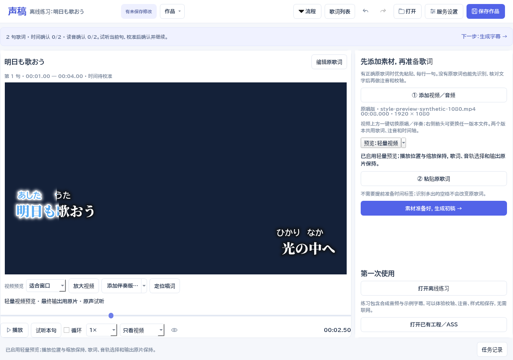

代理保存在本机缓存中，不进入工程或 ASS。重新打开工程后可点击复用，先核对当前文件；换原唱／伴奏、重新载入或同路径替换源文件后，不直接沿用旧代理。取消和失败保留原片、字幕及已完成缓存；原片删除后，仍应先重新定位才能继续输出。

### 大视频与完整波谱

底部播放、速度、播放点和视图选择始终可用。视图分别是：

- **视频＋时间轴**：保留较大的视频，空间不够时中间区域可上下滚动，波谱不会被裁掉。
- **只看时间轴**：把中间空间用于精细打轴，前后句与三个滑条继续可用。
- **只看视频**：放大检查注音和高亮；仍可播放、暂停和定位。

每个制作步骤记住你选择的视图，调整窗口不会自动切走。点 **③ 调时间**、音节或 **尾音细听** 会定位到完整波谱；在样式页打开留屏条也会定位到对应区域。双击留屏边界会回到视频查看效果。

正在时间轴上校对时，展开或收起顶部“流程”会保持完整波谱可见；如果已经滚回视频或选择“只看视频”，继续保留视频视野。

定时自动恢复在后台写入，期间可以继续校对。手动保存、换工程或退出会处理尚未完成的写入，旧任务不会覆盖最新检查点；写入失败时保留上一份恢复记录，并在状态栏提示保存工程。

连续编辑时，恢复记录会合并短时间内的修改，撤销／重做也跟随当前工程。普通窗口按预览所需尺寸显示视频，放大检查时保留源画面的细节；字幕字号、演唱轴及导出分辨率保持各自设置。

视频上的滚轮仍每格缩放 12.5%，双击恢复适合窗口；放大后可在视频内移动视野。“放大视频”临时扩大画面，之后可恢复编辑布局。原版频谱／波形、三个音频滑条及 Aegisub 音频键位保持。

重新载入同一视频、回到开头或暂停定位时，预览会保留对应位置的帧；播放或再次定位会解除保持。载入期间可以先整理歌词，开始精细打轴前仍需等“音频波形已就绪”并试听。若添加素材时提示工程内容无效，先按提示修正工程，再重新导入；被拒绝的导入不会继续音频分析或留下临时播放源。

可下载版本与变更见 [GitHub Releases](https://github.com/ruby4heart/shengao_karaoke/releases)，本机验证范围见 [阶段验收](V030-ACCEPTANCE.md)。交付前请完整试听并检查字幕。

## 2. 生成初稿

推荐点 **按步骤生成初稿…**，一次选好所需步骤。默认离线，在现有整句范围内生成可编辑粗稿；已有且对应当前素材的转录可本机复用。选择联网识别时使用 ElevenLabs 或 Microsoft AI，可另外勾选 DeepSeek 读音建议、ElevenLabs 文字对齐。对话框分别说明上传内容及额度使用，未选择的步骤会明确跳过。

流程依次准备转录、按原歌词匹配／分词、生成读音建议、文字对齐、歌声音节和准备审核，共六个阶段；未选择的阶段明确跳过。选择已有转录或联网识别时，默认勾选 **本机按歌声细分音节**。这一步使用内置 TIFA 和实际音频，无需密钥、不上传、不使用额度；模型限个人非商业使用。可选当前原声或已有且对应当前素材的人声辅助，不改变成片音轨。

歌声对齐以本次假名为约束，并不能证明该假名唱对。勾选微调句首句尾时，在粗轴附近寻找声音边界；额外分析范围受相邻句限制，保留已有重叠，避免短句混入下一句唱词。输入范围本身错误、配到另一个副歌或缺读音时，仍需先圈定正确范围。离线只给了等分范围时不会默认打开声学阶段。已有译文、已确认或人工读音分组保留；锁定、确认过时间或含人工时间的行不会进入整首自动初稿，可以使用本句编辑区的局部重算。

整批只加载一次歌声模型，每句有效结果立即保存。取消后继续只补缺失句子；已验证的数值缓存也能在重新建立流程时复用。审核表增加 **音节状态**：歌声候选、需手工、尚未处理，失败原因可直接查看。展开音节对照可以比较新旧边界、查看读音依据并逐音试听。无效音素或无声区间保留初稿，不用均分结果冒充声学边界；未选择声学处理时，内部音节仍可能是估算。

遇到需手工的行，点 **先手工修这一句**：其他建议先保存到任务记录，再进入该句统一编辑区。修好范围、读音后可以本句重算；暂存建议从任务记录恢复，已经手改或确认的内容不会被旧建议覆盖。候选不等于人工确认，采用后仍需试听；读音确认与时间确认分开，整次采用支持一步撤销。

每步完成后保存本机检查点。点 **查看／继续上次初稿流程…**，可查看各步骤、先审核部分初稿，或继续未完成步骤；任务记录也有继续入口。完成的步骤直接复用，不会重跑。上次未完整返回的联网步骤可能已经由服务端处理，先核对服务记录，再在对话框手动决定是否重试；程序不会自动重发此请求。取消或后台进程意外结束时，也会尽量保留已完成阶段；不存在的服务端响应无法由本机恢复。

保存并重开同一工程，在同一 Windows 用户下仍能找到上次流程。检查点存在本机用户数据目录 `draft-workflows`，不包含密钥，也不嵌入 `.sgproj`；只拷贝工程到另一台电脑不会带走这些检查点。恢复核对原素材与服务配置；素材、流程输入或配置不一致时停止并保留旧记录。工程中途手改、新确认或锁定的行，审核旧建议时保留当前内容，其余建议仍可继续审核。检查点损坏不会触发自动收费重试。

**单独运行某一步（进阶）** 中保留原有工具：

- 离线分词：按原歌词生成词组、假名、罗马音和演唱音节，时间属于估算。
- ElevenLabs / Microsoft AI：在“服务设置”中填写密钥，选择服务后转录、匹配原歌词。已经有转录结果时使用本地匹配，或只对需要的区间重新匹配。
- DeepSeek：为日语歌词补充或复核假名、罗马音和中文译文。先前转录会作为读音依据，特殊唱法仍需试听。

每次返回结果都先审核。查看当前值、建议值、依据和候选时段，试听后勾选需要采用的行。未勾选的内容不会被改写；任务期间被你修改或锁定的行也会保留。

### 重复副歌、漏句或配错段

已有转录或联网转录后的匹配会按原歌词整首顺序处理，并利用前后能确定位置的文字及人工位置约束重复段。已确认、手调和锁定的行只作前后文，内容保留；即使该句没有被识别，也不能让前面的歌词配到它后面。原歌词的空格、分词和已填写读音保持，不按识别空格拆出新词组。

审核中的 **整首顺序检查（匹配时）** 列出漏识别／缺唱候选、重复段位置待定、段落顺序不同、文字对应较弱，以及未分配转录／多唱候选。下拉选择疑点会定位表中对应句，**试听疑点** 带前后音播放，最多 12 秒；较长区间先听开头，再到主界面继续定位。转录中未分配文字忽略空格、标点和假名宽度差异，原始识别仍保留在工程／任务记录中。

没有足够对应的句子保留当前轴，不硬造一个匹配位置。重复候选可能有多个时段；选择后先试听，再勾选采用。候选不能跨越已保留的人工位置；超出自动文字前后文的备选会明确提示。分数只表示文字相似程度，不能证明唱法或演唱起止。漏识别可能由识别错误造成，不能直接称为实际缺唱，多余识别也不等于真的多唱。

**定位到主界面校对** 先把本次建议保存在任务记录，再进入该句整句范围、分词和假名编辑；当前工程不先应用建议。**限定正确时段重匹配** 同样先暂存，再让你试听并填写正确区间，只复用已有转录匹配这一句，不重新上传或提交付费识别。它是明确的局部重做，可替换该范围内原有手调时间，但仍先审核；锁定内容必须先解除。取消范围选择时原内容及暂存结果保留。采用后可一步撤销，其他歌词保持。

该清单记录匹配阶段的判断，后续手工或歌声调整不会自动把旧记录改成新结论。整首分阶段流程及任务恢复保留这份依据；旧版已完成任务保持原检查点，不会为了新增检查自动重跑或收费。整首结果不理想时，可明确使用“使用已有转录，重新匹配”在本机生成新候选。

新初稿默认保留原始间隔。校准页 **检查空白…** 根据声音与保留的音素依据提出候选，先试听再采用；下一起音和人工边界保持。旧的按时长收拢功能移入进阶区，独立开关默认关闭；固定阈值不能识别真实休止。完整步骤见第 7 节。

密钥加密保存在当前 Windows 用户的数据目录，不进入工程。保存设置不会发起收费请求。任务超时或取消时，服务端可能已经接收请求；先查看任务记录和返回结果，再决定是否重新提交。

### 复用已经校对好的副歌

同一段唱了多遍时，先校对其中一句的原文分词、假名、罗马音及演唱时间，分别确认读音和时间。回到 **生成初稿** 页，直接点 **复用已校对副歌…**；不需要重新转录或配置 API 密钥。选择已确认的来源句，再选择原文完全相同的目标句，可分别试听。来源是假名文字依据，另一遍仍可能采用不同唱法。

来源的词组、原假名写法（包括片假名）及罗马音复用到目标。目标保留自己的原文、译文、演唱范围和手工留屏设置；来源的演唱节奏、锁定和确认状态不会复制。已人工修改时间、读音、已确认或锁定的目标会列明保留原因，可直接跳回主界面处理。原文空格／标点不同的句子不强行套用，先核对原文。

默认 **按目标段歌声重新计算音节时间**：可选当前原声或对应的人声辅助，并选择是否微调粗略句首句尾。处理在本机运行，TIFA 权重限个人非商业用途，不上传音轨，也不使用 API 额度。相邻歌词限制声音搜索范围，未选中的歌词不跟着重算。若取消声音选项，只生成分词读音候选；其中音节仍在本句旧范围内估算，尚未校准。

结果仍先审核，逐音试听后勾选需要采用的句子。没有形成声音候选的行会保留复用读音和待校准范围，不能当成已完成时间；可先手工校对，也可从任务记录继续本机处理。来源句、目标或确认状态在后台期间发生变化时，旧建议保留，不静默覆盖当前内容。采用不自动确认目标的读音或时间，可一步撤销、保存和重开。

在 **任务记录** 里选原任务或暂存的校对建议，点 **继续所选处理流程…**。来源、素材和歌词未变时复用原检查点；已经完成的任务直接回到审核，不重新运行模型。工程或确认状态已变时保留旧结果，按当前内容重新选择复用；已有本机声音缓存仍可使用。检查点在本机用户数据目录 `chorus-workflows`，不嵌入工程；仅拷贝 `.sgproj` 不会带走这些任务。

## 3. 对齐与校对

本句编辑把原文、词组、假名、演唱音节和起止时间放在同一区域。先听整句，再改分词、读音和边界；右侧可以滚动，底部确认按钮始终保留。原文如何组合，与某个假名何时亮起，是两个层次。

拖动时先看目标位置，松开后提交这次修改；一次拖动对应一步撤销。长工程也保留邻句、手工读音与确认记录；遇到无效数据时保留修改前的工程，并显示原因，不把未完成的提交当作已保存。

视频上方的 **① 分词、② 注音、③ 调时间** 会定位到同一个编辑区。**尾音细听** 直接展开主界面细听，另有独立放大的精细工具。

点击 **① 分词**，在原文某字前增加分界，点击已有分界合并；也可先按词典切分或合为整句。同一个预览中可多次调整，应用前列出需要重估的词组。相同跨度的人工读音和音节保留，合并保留原有音节与实际间隔，只有新切开的词组需要重估。原文和真实空格保持，不建立纯空白词组。先应用或取消预览，再保存、切句或继续编辑；一次应用可一步撤销。

未匹配、没有词组时，先点 **整句范围**，在起止框确定实际唱词范围并应用、试听，再分词。没有假名也能先定范围。修改已有整句头尾不会自动拉伸所有内部边界；整段偏移使用下方整体校轴工具。

点击原文词组或表格原文，直接在假名格中填写实际读音。也可点 **② 注音／直接改假名**，不打开模态窗口。原文汉字保持，罗马音跟随读音变化；只重估变动词组的内部音节，其他人工数据保留。展开 **罗马音与中文译文（可选）**，显示罗马音列或手工修改译文。词组锁定不会阻止编辑其他词组；涉及锁定边界的修改会整体拒绝。

点击演唱音节选中并定位，右键直接试听；下方时间框、原文词组、表格和原版时间轴同步。点击音节会退出整段拖动，以便修改当前边界。视频下方 **定位唱词** 按当前播放点选中对应句和音节，不将播放点跳回开头，也不修改时间；演唱重叠时保留当前句，间奏选择最近句。更改分词后，仍选中原来对应的词组与音节。

旧工程有假名却没有细音节时，使用 **补全音节**，先看预览，再应用。它按现有假名与词组范围均分时间，属于估算，不是声学识别。原假名（含片假名写法）、罗马音、词组起止、已有人工音节保留；锁定、缺少有效假名或范围过短的词组会列明未处理数量。补充后需要试听并重新确认时间，原读音确认保持。外部复杂 ASS 改用声稿排版时，预览会提前说明，原 ASS 仍保存在工程中。

后台返回建议时，先提交正在输入的有效内容；失去窗口焦点也不会遗漏编辑缓冲。建议仍需审核，已修改的行会保留当前值；后台保存转录不会丢弃未应用的分词预览。

### 读音拿不准时，比较候选再试听

在 **② 注音** 选中词组，下方直接显示 **读音候选**。先看当前假名，再从下拉框比较词典的其他读法，例如「人気」的「にんき／ひとけ」、「明日」的「あした／あす」。依据区会说明来自词典、转录假名还是已保存的 DeepSeek 文字建议，内容较多时可以在框内滚动阅读。候选不会自动改工程。

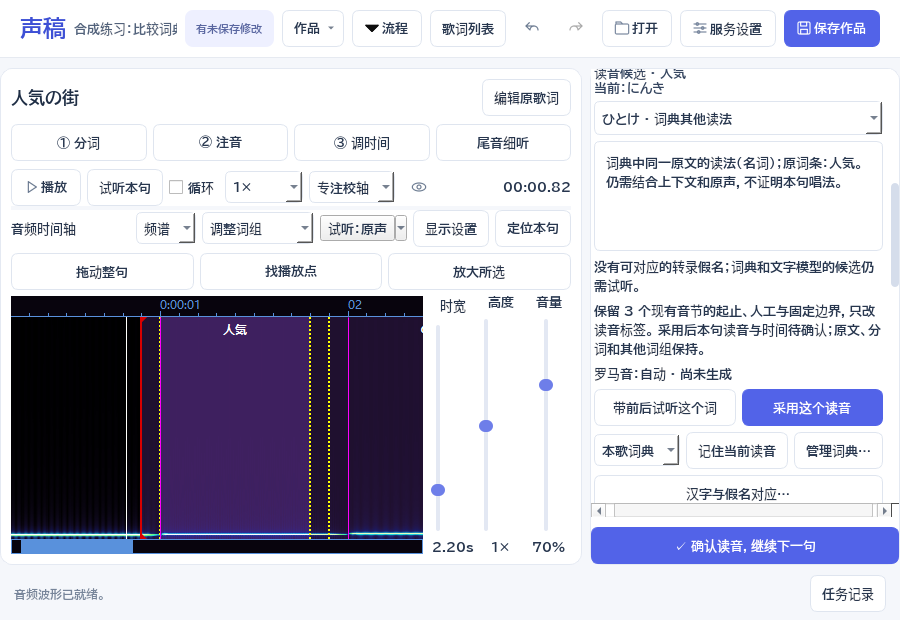

图为合成练习歌词与软件自身界面，不表示练习音轨演唱了这些汉字，也不作为歌曲准确率证据。

点 **带前后试听这个词** 播放当前实际音轨，范围包含词组前后各 180 毫秒；它不会把候选合成为语音。原声／人声切换沿用已有试听轨。没有可读取素材时先添加素材，文字候选仍可查看。转录仍是汉字时不能证明实际读音；假名转录也只是待复核识别文字。旧转录绑定另一素材时不用于候选。

看清下方的音节处理说明，再点 **采用这个读音**。音节数相同时保持现有起止、间隔、人工与固定边界，只改读音标签；原来的歌声音素依据仍对应旧读音，需重新试听。音节数变化且没有逐音人工／固定边界时，在原词组范围内重新估算，不能当作新声音识别。有人工或固定边界而音节数不兼容时，本入口保持旧轴、说明原因；保留这些边界的手工拆合仍在后续待办。上方直接填写假名仍是原来的手工重建入口，会重估本词内部音节，应按其提示重新校准。

采用只改变所选词组；原文、分词、其他词组和整句范围保持。本句读音与时间恢复待确认，一次撤销恢复此前数据与确认，工程和声稿 ASS 保留选择记录。锁定、迟到的本句／素材／确认变化会拒绝旧候选。时间页收起候选；回到注音页继续比较。

需要 DeepSeek 时展开 **复核本句读音与译文**，明确点 **DeepSeek 复核／翻译**，审核后采用；已保存且仍对应当前词组的文字依据可在这里查看。查看候选本身不联网，也不会自动重发付费请求。歌曲与个人读音词典、特殊唱法对应和翻译长度提示仍在 ToDo。

### 记住特殊唱法：本歌和个人词典

在候选区选 **本歌** 或 **个人**，点 **记住当前读音**。保存的是已经填在本词上的读音，不是尚未采用的候选；不会改时间或自动确认。本歌词典跟随工程，Ctrl＋Z 可撤销。个人词典跨工程使用，只保存在本机，用 **撤销本次个人保存** 单独撤销，避免影响工程撤销。

点 **管理词典…** 可增删、修改备注，或导入合并／导出 JSON。取消保留原词典，保存才应用。相同原文可以有多个唱法，它们进入候选供试听选择，不会自动替换歌词。导出只包含当前范围的词条；个人文件损坏时保留原件并提示，不覆盖为空词典。

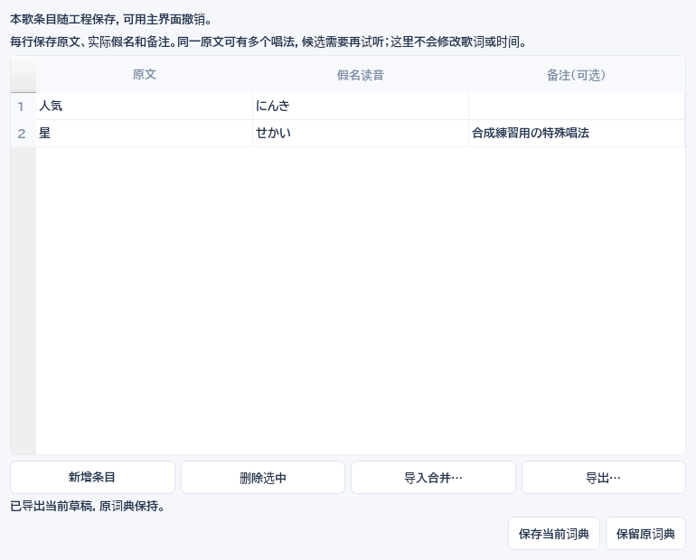

### 注音放错汉字时，调整对应

选中词组，点 **汉字／假名对应…**。这里只改注音位置；实际假名、音节时间、固定点和确认保持。普通送假名用 **自动对应**，熟字训或特殊读法可用 **整词注音**，也可隐藏本词注音。

**手工指定原文与假名范围** 使用从 1 开始的字符位置。选中已有段后用 **更新选中段**，其余段用 **加入新段**。例如「お星様／おほしさま」，保留「お」，将「星」对应「ほし」、「様」对应「さま」。不能漏掉送假名、重叠或拆开「きょ」等拗音。下方预览使用实际 ASS 渲染；应用前工程和播放位置保持，采用可一步撤销。手工对应存在时，重新分词会提示先恢复自动，防止丢掉对应。

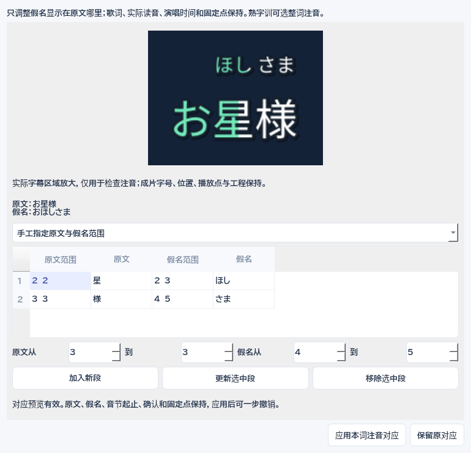

### 罗马音自动拼写与手写覆盖

点 **罗马音规则／手写…**，选择当前词、本句或整首，比较当前拼写和修改后结果。可选实用ヘボン式、旧式训令拼写、长音假名写法或词典长音符号，以及助词 wa／e／o。只有词典读法与已填假名一致时才采用其长音信息，不把所有「ou」盲目缩成「ō」。特殊唱法仍需人工判断，规则说明见 [罗马音依据](ROMANIZATION-REFERENCES.md)。

手写覆盖只针对当前词；批量自动处理默认保留手写、来源未记录的旧值与锁定内容。要恢复某词的自动拼写，明确选择 **当前词组 → 按假名自动生成**。勾选 **本工程新词默认** 才影响后续新词；已保存的词级规则仍保留。假名变化时已记录自动拼写随之更新；手写和不明来源旧拼法保持，并提示 **假名已改，请复核**。这些操作只改显示，不改假名、时间或读音确认，可撤销。

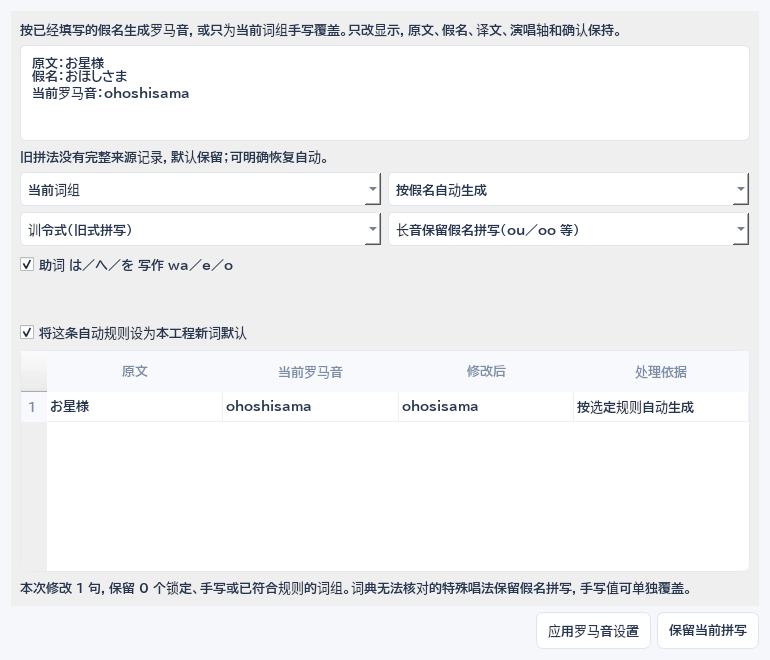

### 译文只改译文，DeepSeek 不生成时间

译文栏显示 **DeepSeek 初稿、手工修改或旧译文来源未记录**；直接输入即可人工修改。长度提示按当前字体和字号测量，超出安全宽度时提示精简译文或调整译文字号，不截断原文。**译文已核对** 是可选的独立确认，不影响日语读音或时间确认。

DeepSeek 只接收文字并提出读音、说明和译文，不提供歌声边界。新建议先审核；已有手工、已确认或来源不明译文保持，新译文在本句显示供比较，可选 **采用已保存译文建议** 或 **保留当前译文**，都能撤销。原文改变后旧译文提示复核，旧原文的新建议不能直接采用。

AI 或本地读音建议改变假名时，相同音节数保留人工时间、间隔和固定点；数量不同时保留旧轴，并把未采用的候选与原因留给人工处理。明确的手工假名编辑仍可重建本词音节，操作前应先确认要替换的范围。文字模型生成的额外时间字段不会作为歌声依据；其余词组和原文保持。音节拆合、主界面细听与集中疑点按下面步骤使用。

### 在主编辑区细听

选中一个演唱音节，点视频上方的 **尾音细听**。没有选中音节时会定位本句最后一个音；没有匹配或音节时，仍可按整句范围试听。

在展开的 **主界面细听：慢放、循环与辅音增强** 中：

1. 用 **带前音试听** 判断两个音的衔接；用 **只听所选** 对照当前选择。
2. 选择 0.5×、0.75× 或 1× 细听速度，按需打开 **细听循环**。
3. 尾音较弱时试用 **突出辅音**。这只是试听增强，不能证明到底唱了哪个音。增强时视频保持定位静帧，主播放点与字幕跟随试听声音。
4. 点 **关闭增强并听原声对照**，回到当前视频原声音轨比较。若需人声辅助，仍用音频区的 **试听：原声／人声** 切换。
5. 点 **停止细听**，或用主播放按钮停止。普通播放、定位、换句和换源会结束临时细听并恢复常规速度、循环设置；工程及成片音轨保持。

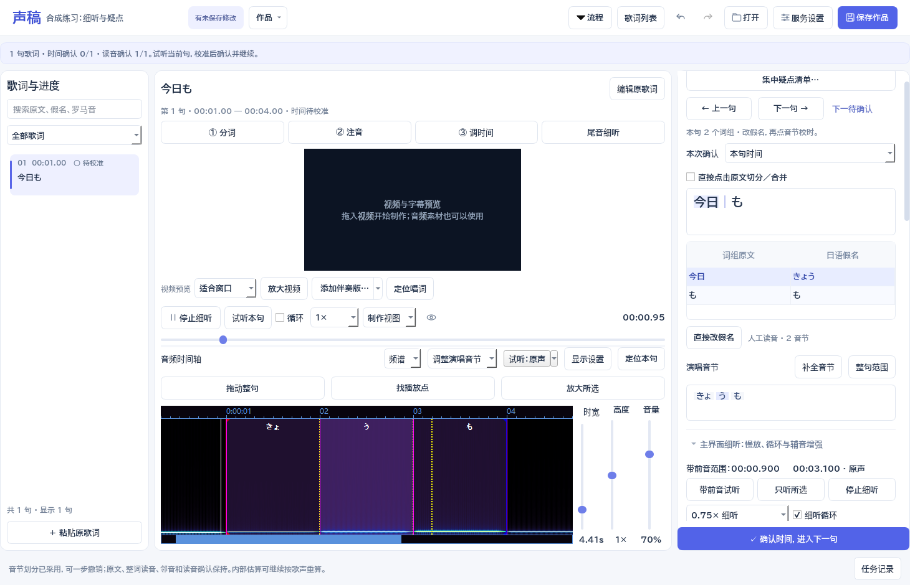

需要更大频谱或在独立窗口微调时，点 **独立放大与微调窗口…**。主界面的起止输入、拖动、Aegisub 默认音频键位及三个滑条继续可用。

### 拆分、合并演唱音节

先点击演唱音节，再展开 **音节拆分、合并与恢复默认**。这里改变扫亮的音节划分，原歌词、整词假名、罗马音、译文和注音对应保持。

- **预览拆分**：选择假名内部的位置，例如「きょ │ う」。默认内部时间只是估算。
- 已听准分界时，点 **填入播放点** 或填写时间，并选择 **用所填时间建立内部人工固定点**，再预览。
- **预览合并**：从当前音节合并到下拉选择的同词相邻音节。存在人工内部边界或间隔时，需要分别明确选择允许移除或并入。
- 绿色固定点不能被这些选项绕过。确需解除时，使用已有的 **取消所选音节的固定点**，然后重新比较。
- **预览本词默认摩拉划分**：恢复该词正常摩拉组合。相同边界保持，新内部位置仍是估算。
- 特殊唱法确需拆开「きょ」时，先打开 **高级：允许在拗音内部按字符拆分**。单个假名可改时长或与邻音合并。

比较当前与预览起止，带上下文试听后，点 **采用这次划分**。一次操作一步撤销；时间恢复待确认，读音确认保持。不同词组的人工边界不受影响。

之后可用 **固定位置后局部重算…** 在本机按歌声重算。不可对应标准摩拉的手工段保持，只计算其他可对应部分；不需要先丢掉手工划分。模型无法处理的部分继续手工校准。

### 从集中疑点开始校对

点校对页的 **集中疑点清单…**。清单不锁住主编辑区，可以筛选类型、程度、处理状态，按歌词顺序或严重程度排序，也能搜索歌词和提示。

每项显示原因、当前值和建议。未匹配、读音分歧、缺音节、异常时长、音节／词组间隔、错段候选、范围与排版分别列出。词典中存在多个读法本身不等于唱错；长音和间隔也可能合理，需试听后决定。

1. **定位到编辑处** 定位到对应句、词或音节；**带前音试听** 使用主界面细听。
2. **前往手改** 收起清单并到相应编辑入口；改好后重新打开清单。
3. **打开对应工具** 可进入限定区间重配、声音空隙审核、注音、分词或样式等工具。
4. 只有有明确本地候选时才启用 **采用这条建议**。例如只为当前词补估算音节、采用已经保存的假名或译文候选。先比较，再采用；原文及人工保护继续有效。
5. **保留当前** 记住对这一条依据的决定；**暂缓** 留待后续处理，仍计入待处理。二者都不会把时间或读音设为已确认。
6. 用 **撤销上一步** 撤销工程操作，包括本次处理记录；搜索输入框内的撤销仍只改搜索文字。

素材、读音、时间或相关建议变化后，旧决定重新变成 **需重新检查**，上次比较内容仍可查看。已经采用过的问题再次出现时，也会重新列出，不能被旧记录隐藏。新后台任务不覆盖人工编辑；过期建议可比较，实际采用继续经过原审核保护。没有返回结果时保留任务线索，不自动重复提交付费请求。

顶部显示当前待处理数量、直接采用的记录和独立的时间／读音确认进度。采用后问题可能消失，不代表整句已确认。听准后回主界面分别确认；**下一待确认／Ctrl+J** 仍按所选确认类型导航。

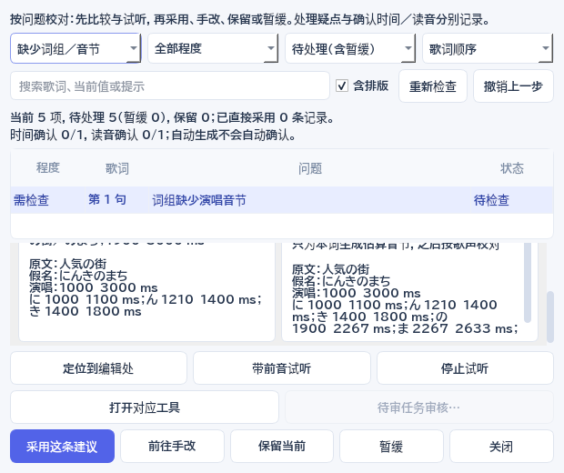

### 用几个正确位置引导局部重算

确认假名并补全音节后，点 **固定位置后局部重算…**。窗口复用原版频谱／波形，保留相邻句参照。左键选音节、右键试听，中键定位播放点；滚轮平移，Ctrl＋滚轮缩放。选择音节和“起点／终点”，试听后点 **读取当前播放位置**，也可直接输入毫秒时间，再点 **加入／更新固定位置**。绿色虚线标出固定点；表格按歌词顺序列出，可点回对应位置。

默认至少给两个位置，**只重算首尾固定位置之间**，范围外音节保留。也可明确改为“重算本句所有未固定部分”。固定一个起点不会把这个音节的终点也算作人工确认；已有人工音节、词组锁定、固定点及整句头尾保持。整句已确认时间时须先解除确认。固定位置与保留的邻音冲突时，先扩大范围或手改邻音，不静默挤动范围外的时间。

点 **生成局部重算候选** 后在本机按实际歌声计算，无需 API 或上传。返回后仍须用 **比较并审核歌声音节建议** 试听、勾选采用；采用可一步撤销，读音确认保持，时间不自动确认。原始模型音素范围与人工固定边界分别记录，不能把人工给定位置的零误差当成模型准确率。

定位草稿边改边存；**保留草稿，稍后继续** 或关闭窗口都不改工程，重开可继续。任何区间失败或取消时，整句原轴保持；在 **任务记录 → 继续所选处理流程…** 重新打开固定点，或用 **返回本句手工校对** 直接划音。工程、素材或本句版本变化时拒绝恢复旧定位，原记录保留。已经生成的建议仍可恢复审核，处理中发生的人工修改不会被覆盖。

采用后固定点随 `.sgproj` 和声稿导出的 ASS 保存；以后本句歌声重算继续遵守这些边界，整首自动匹配与初稿不会覆盖它们。选中该演唱音节，点 **取消所选音节的固定点** 可解除其固定起止点，当前时间与选择保持，也能撤销。改变假名或分词属于明确的人工编辑，涉及重建的音节需重新检查固定点；整体手动校轴会按所选范围一起变换时间。

### 整体校轴之后，想再计算内部

部分区间失败时仍保留原来的轴和保护，不把部分结果当成完整缓存；再次明确重试仍会实际计算。固定点窗口也可把已有人工边界选为只读范围参考，保留原来的时间与人工属性。

整体提前／延后、渐进校正或确认时间后，旧估算也可能被保护。仍点原来的 **按本句原声／人声重算音节**；检测到这些旧保护或本句已确认时，程序先打开 **重新计算旧估算内部**，不增加另一套入口。

先看列表中的处理依据。默认不勾选 **允许重新计算这些旧估算保护**；需要重算时明确勾选。已经确认时间的句子，还须勾选 **允许重新计算已确认的本句**。只允许重新打开时间确认，不等于同时允许释放旧估算，两项选择分别起作用。整句范围、人工词组范围、真正逐音调整、锁定和固定点保留；来源不明的旧人工记录继续保护，不猜测它是否校准过。

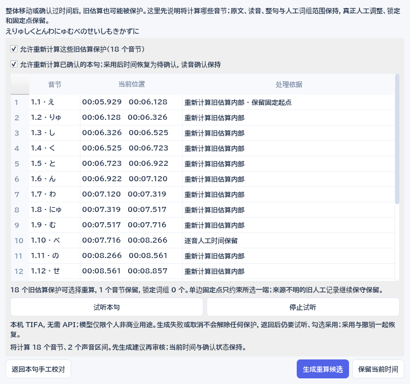

图示为公开 PJS056 受控初稿，已经明确勾选两项允许；初次打开默认未勾选。音频：Shinnosuke Takamichi 等；人工标签：UtaUtaUtau。示例时间与界面为演示处理，图中示例及衍生截图按 [CC BY-SA 4.0](https://creativecommons.org/licenses/by-sa/4.0/) 提供；来源及原许可保留在随包公开示例资料中。它不是正式 MV 成品或一般歌曲准确率证明。

点 **生成重算候选** 后，在本机按声音计算；当前工程的时间、保护和确认状态仍不变。返回后用原来的建议审核窗口试听、勾选采用。采用后读音状态保持，时间恢复待确认，一次撤销恢复重算前的时间、保护和确认。整段纠正后的整体位置保留；没有重新平移整句，也不把均分当作声音识别。

没有生成成功的区间保留原数据，取消不解除保护。请求和选择保存在任务记录，**继续所选处理流程…** 可重新打开并确认选择；暂存建议、保存重开及旧结果审核沿用原来的入口。素材、本句或原始请求变化时拒绝旧候选。若列表说明旧人工改动无法区分，或某音节另有逐音人工记录，则继续保留，可返回本句手改。只固定一端的规则仍生效，但不会因此绕过该音节的其他人工保护。

本开发版保存第 14 版工程，读取 1–14；保留歌曲词典、注音对应、音节拆合、疑点决定和歌曲标识，新增本句排版。0.29.0 及更旧程序不能打开新版，请另存副本并使用新版继续。旧程序和原文件保留。

### 看懂当前时间是怎么来的

选中词组或音节后，起止框上方直接显示 **字符／单词时间参考、估算音节、歌声候选或人工调整**。字／词参考提供外部范围，内部假名仍可能均分。整体移动后的估算仍是估算；“已保护”只防止自动覆盖，是否确认另看对应复选框。

点 **来源／提示**，逐层比较原始依据和当前范围，筛选估算、歌声候选、人工调整或未确认提示。带前后音试听，点 **去校准所选** 回到对应音节，起止框与时间轴同步定位。来源窗口本身只读；打开前的有效输入先按原流程提交，分词预览须先应用或取消。短音、长音、固定规则延尾、旧声音依据与当前假名不一致等仅作为试听提示，不自动修正或冒充模型准确率。

手调边界后记录人工调整，确认时间仍保留原始来源；修改、保存和撤销一起恢复。旧工程没有记录字／词粒度时不猜测；旧 TIFA 记录只有保留的音素区间能对应当前边界时，才只读说明其声音依据。改读音或边界后提示复核，不重复调用服务。

整体错位时，展开 **整体错位（本句／多句／整首）**，选择本句、选中多句、从这里到结尾或整首。Ctrl 点选、Shift 连选；偏移、移到播放点、拖动使用同一范围。点 **整体提前／延后…** 先预览、试听，再一次应用。相对时间和读音保留；时间需要重新检查，读音确认保持。

开启 **“拖动整句”** 后，同一个修改范围也用于拖动；即使旧时间不在当前视野，也能把本句抓到鼠标位置。Alt＋左键拖动可临时移动。拖动显示旧位置、目标和偏移量；到边缘会连续平移视野，松开才提交，Esc 取消，Ctrl＋Z 一步撤销。锁定冲突会明确指出，不会只移动范围中的一部分。

展开 **“逐渐偏移／配错段／整首概览”**：对开头准确、后面越来越偏的轴，选择至少两个原字幕位置及实际歌声位置，可试听并用播放点填写；必要时加入更多位置，位置之间逐段校正，两端以外只平移。副歌配错段时指定正确时间区间，使用已有转录在本地重新匹配，再审核采用；范围以外的内容保持。整首概览只移动视野。单句头尾有误可用“整句范围”；需要重估整句内部时间时，进阶单独分词窗口仍可使用。

在 **微调、空白与字幕留屏** 中展开 **本句字幕出现／消失时间**，可独立改本句的留屏范围，必须覆盖演唱时间；也可将修改范围恢复为自动显示。整首校轴同步移动画面显示时间；局部修正保留人工留屏并确保覆盖演唱。新出现的演唱重叠是检查提示，允许保留实际合唱。

“找播放点”只把视野移到当前播放位置，“定位本句”找回整句及上句衔接，“放大所选”看清当前音节。这些按钮不会改变时间。

旧初稿有多余空白时，优先用 **检查空白…** 逐项试听。进阶区 **只按时长处理空白（高级）** 仍可选范围与阈值；该旧方式只按时长处理，不能确认歌声连续。

精确对齐的缓存保留原始字符时间，改变连续划音选项时会在本机重新计算，避免为同一份缓存再次请求接口。

时间轴上方的青色轨显示上一句，紫色轨显示下一句，与本句频谱共用同一刻度。边界标记分别代表上句唱完、下句开唱；橙色提示演唱重叠。单击邻句音节直接校准该音节，右键试听；有空间时也显示“改上句／改下句”和衔接试听按钮。小窗口合并参照说明、收起按钮，仍保留音节轨和完整时间轴。演唱重叠可能是真实合唱，需试听判断；与双行歌词有意同时留屏不同。

- 词组 / 音节模式：左键选择或拖边界，右键试听，中键定位视频。拖动时同步显示临时范围，松开才提交，一步撤销。
- 整句模式：左键设置开始，右键设置结束。单独调整整句不会重新分词或改写原歌词。
- 拖上方刻度平移，滚轮平移，Ctrl＋滚轮缩放；启用吸附后可对齐关键帧、邻句和当前播放位置，Shift 暂时关闭吸附。
- Ctrl＋拖动内部边界可移动后续边界。边界受前后顺序约束，不能把音节拖成负时长。
- 在“微调、空白与字幕留屏 → 微调与空白时间”中试听间隙，选择保留、并入前一音节或后一音节；整次操作可撤销。
- 假名直接在表中修改，罗马音会跟随更新；也可手工改罗马音。原文中的汉字保持原样。

时间轴上方 **“频谱／波形”** 直接切换原版显示，保留当前时间位置和选择，并记住偏好。“显示设置”可选择波形平均值、质量、频率曲线与增益。原版 Icy Blue / Green 配色、刻度、句界、音节线和歌词标记用于辅助找起音。自动时间属于初稿，最终以实际演唱和人工确认结果为准。

音频区右侧三个竖滑条从左到右是 **时宽、高度、音量**。时宽往上拖会放大时间，便于抓边界；高度调整波形／频谱的显示增益，让弱音更明显；音量只调整试听声音。前两个双击恢复默认。三个控件均不改变素材、字幕时间或导出音量。

尾音难听清时点 **“尾音细听”**，默认选中最后一音，在主编辑区按上文步骤慢放、循环及对照。需要更大频谱时点 **独立放大与微调窗口…**；显示增益和“放大当前音”帮助观察弱音。试听增强不改变工程、音节证据或成片音轨，伴奏也可能影响判断。

在细听窗口拖边界、改开始／结束或用 10ms 按钮微调；必要时修正一个音节的假名，例如“て”“す”“きょ”。整词读音在本句表格修改，原歌词错误则用“编辑原歌词”。点“保存本句修改”才写回工程，整次可一步撤销；取消保留原值。关闭窗口后恢复原来的试听速度与循环设置。

时间框显示“分:秒.毫秒”，支持 `01:23.450`、`83.45` 秒或 `83450ms`。也可用当前播放位置直接设置起止。

**本次确认** 选择底部按钮确认时间或读音，所有字段始终可达；点读音编辑时自动选择读音，点时间框或音节时选择时间。两项也可分别勾选。底部按钮完成后寻找下一句对应待确认内容；Ctrl＋J 找下一待确认句。AI 初稿不会自动成为人工确认，锁定仍保护自动处理。Ctrl＋Z／Ctrl＋Y 撤销与重做。

时间轴获得焦点时采用 Aegisub 3.5.0 Audio 默认键位：R 听整句，S／空格听所选，B 试听所选或停止，Q／W 听前后 500ms，E／D 听开头结尾 500ms，T 听到媒体末尾，H 停止。Z／X 或方向键切换音节；整句模式切换句子，A／F 平移 128 像素。C／V 增加 100ms 引入／350ms 引出。小键盘 −／+ 微调 10ms；Shift 加小键盘 −／+ 同时移动后续内部边界。音节模式不通过长度键改变整句头尾。

默认Enter／G提交时间后**按原稿顺序**进入下一句；可在显示设置关闭自动进入下一句。Shift+G在整句模式将下句重置为3秒，音节模式保留下句原时间。“作品 → 打轴快捷键设置”可查看、修改及导入键位。Medusa小键盘默认关闭，可在该设置中启用，或时间轴聚焦时按Ctrl+小键盘*开关；默认小键盘5试听、8停止、0／2切换、4／6改起点、7／9改长度。新用户默认开启输入保护，编辑文字、时间和表格时不打轴；旧版已启用的原版Always行为迁移保持，可主动勾选保护。F6试听本句、Ctrl+Enter确认本句时间并寻找下一待确认句仍可使用。

## 4. 字幕样式

点击 **“应用双行接唱 · 日式注音”**，使用上左、下右交替的卡拉 OK 模板。默认唱到本句约 50% 时提示下一句，最多提前 3 秒；上句从下句出现起保留约 3 秒，正在演唱的内容不会提前消失。短句会缩短留屏给新句让位，间奏会清屏。超过两句实际同时演唱时，临时增加字幕行并提示检查重复歌词匹配。

双行排版按邻近的显示内容计算，不再用远处异常重叠歌词挤走当前句；过密重叠会临时缩小以留在画面内，请先校对重叠时间。暂停时若播放位置没有字幕，切换显示或应用模板会定位到本句，方便立即查看效果。

展开“调整接唱速度与光晕”可改变提示进度、保留时间、提前量和光晕。“本句显示”与“演唱”分别显示画面留屏时间和音节轴时间。提前出现的句子保持未演唱颜色，高亮从原来的音节起点开始。默认模板隐藏罗马音和译文，需要时可重新勾选。仍可切回“逐句显示”。

正文保留原歌词真实空格；分词不会额外撑开正文。假名优先贴在对应汉字词组上方，例如“お相手は”只在“相手”上方显示“あいて”。读音取自你已填写或采用的结果，不会在排版时重新猜读音；如果汉字与送假名无法唯一对应，保留整词注音，需试听核对。熟字训等整体读音保持一组。

用当前歌词预览模板，分别控制假名、罗马音和译文的显示与字号；原文与罗马音共用主字体，假名和译文可以单独选择字体。常规文字、高亮、描边颜色在样式中统一设置。

### 在同一时间轴调整字幕留屏

到“调整样式”，点 **在时间轴调整出现／消失**；也可在音频区打开 **字幕留屏**。留屏条与原版频谱／波形使用同一时间刻度，显示上一句、本句和下一句。细蓝线是实际演唱范围，彩色条是字幕出现到消失的范围。

- 拖左端改出现，拖右端改消失；未改的另一端仍可跟随自动接唱。
- 拖条的中间可平移整个留屏范围。所有操作都包含完整演唱，不会裁掉音节。
- 拖动时先显示预览范围，松开一次采用。**Esc** 取消，之后松开也不提交；**Ctrl+Z** 一步撤销。
- **Home／End** 选择出现／消失边界，左右键微调 10ms，Shift 加左右键微调 100ms。
- 点邻句可以选中它，时间视野保持；双击边界可查看该句出现或消失的位置。

调整下一句出现时间后，上一句的自动留屏会跟随；明确设置过的消失时间保持。短句密集时只缩短已经唱完的自动留屏，不会删掉正在唱的内容。明确的手工留屏或真实演唱重叠超过两行时，使用临时行并提示检查。

留屏只改变画面显示，原歌词、假名、罗马音、译文、词组与音节轴、锁定和确认保持。复杂原 ASS 先选择声稿样式，原字幕继续保留；期间改了相关歌词、确认、素材或接唱参数，旧拖动会取消。

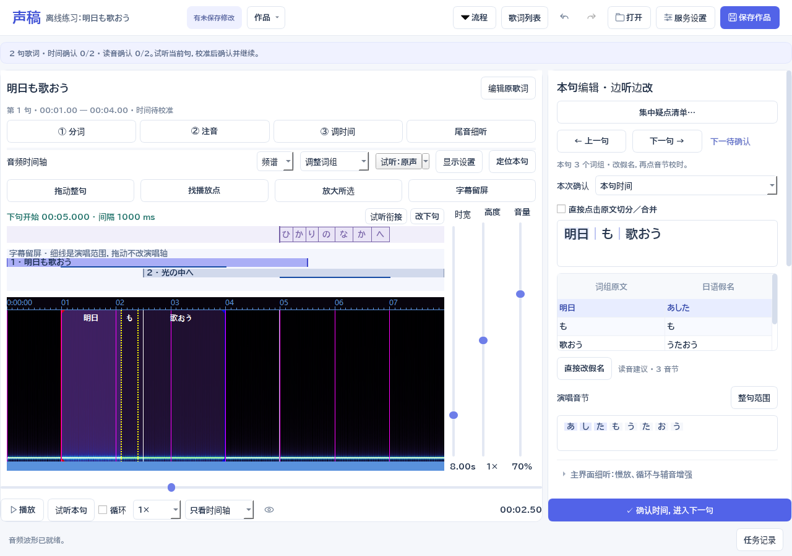

### 用实际歌词比较字体

到“调整样式”，点 **比较字体／修正本句排版…**。上方显示当前静止视频帧上的完整字幕，下方放大本句；四个比较图使用相同歌词、假名、字号、接唱位置和已有配色。可以分别查看演唱中、待唱、唱完留屏。所选句没有待唱或留屏区间时，会说明当前改为比较演唱中。

比较不会移动主播放点或修改工程。背景保持打开窗口时的静止视频帧，字幕时刻单独标明；并不代表播放器已跳到该时刻。

- 点字体卡选择正文／假名字体组合，译文字体、详细状态颜色、留屏与演唱时间保持。
- “整首”字号、描边和阴影作用于全局；字号仍按 1080p 设计，输出时缩放。
- **采用字体与本句排版** 一次提交，**Ctrl+Z** 一步撤销；取消保留原设置。

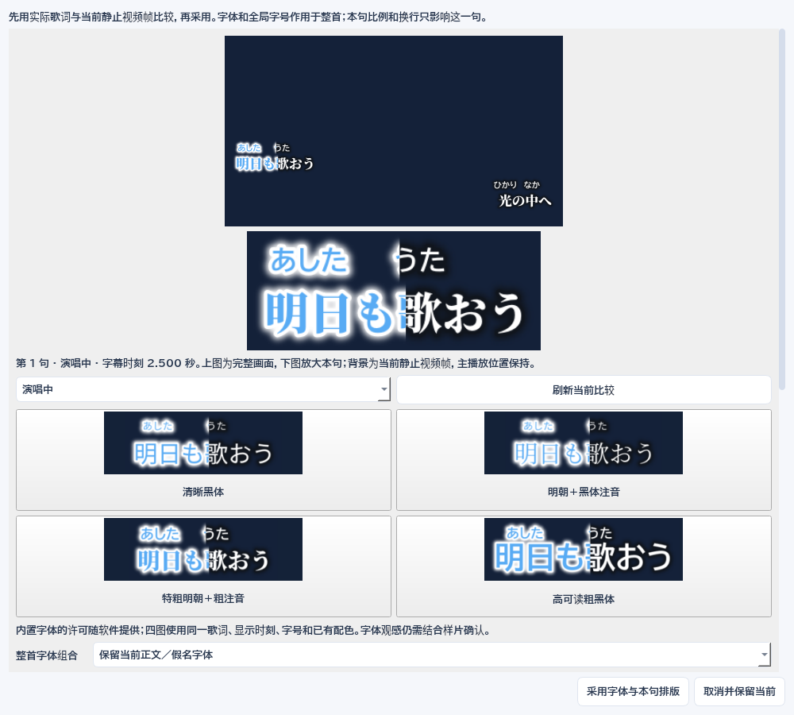

### 只修正这一句的字号和换行

在同一窗口调整 **本句整体字号 %** 和 **本句假名额外比例 %**。整体比例也影响本句罗马音、译文、描边与阴影，假名额外比例只在此基础上调整注音；其他歌词的设置保持。

勾选词组之间的换行位置，最多八处。换行仅用于画面排版，原歌词、词组、假名对应、音节及人工轴保持，不会产生新的空白时段。尚未分词的句子也可以在完整字符之间选择显示换行，不会凭此生成词组或声音时间。

需要在一个词组内部换行时，点 **到本句分词处调整词界…**。此操作关闭尚未采用的排版预览，进入当前句分词；可先采用当前设置再重新打开继续。**本句恢复全局排版** 清除本句比例与显示换行，仍需采用后才生效。

原文或分词改变后，旧换行设置仍保存在工程中，不再适用的位置暂不显示，并提示复核。只改字体或比例会保留旧依据；明确选择新词界或恢复全局排版后才替换它。集中疑点清单的“排版”项可定位受影响的句子，并直接进入修正窗口。

保留原 ASS 的工程须勾选 **采用声稿排版** 才能采用新设置，原 ASS 源文继续保留。窗口打开期间工程或素材变化时，旧预览不会覆盖新编辑，请重新打开比较。

### 分别设置唱前、唱中和唱后的颜色

在样式页点 **“颜色与演唱状态…”**。先选择作用范围：全曲模板、本句或选中歌词；切换范围会重置这个窗口尚未采用的修改。全曲模板不会覆盖已有的指定行配色。

可先用“白字／蓝色扫亮”“高对比黄字”或“日式蓝字／白色描边”预设，再选择正文、假名注音、罗马音或译文，以及待唱、演唱中、唱完留屏状态。文字色、演唱中尚未扫亮的底色、描边和阴影都可选颜色并设置不透明度，0% 为透明、100% 为不透明。正文／假名可以连续扫亮或到达时切换，描边和阴影可按整句状态切换或跟随扫亮；罗马音和译文按整句变色，不虚构逐词时间。

“显示独立背景底板”控制整句文字与注音后方的底板，颜色与透明度也按三种状态设置，可调边距和圆角。底板与阴影独立；描边粗细和阴影距离仍在样式页调整，数值为 0 时相应颜色不可见。

窗口用当前视频帧比较配色，“看待唱／看唱到一半／看唱完留屏”切换字幕状态，播放器位置保持。若本句没有提前显示或留屏，会说明该状态没有显示区间；先在显示轴设置时间后才有实际效果。文字层未开启、当前句没有译文或尚未分词时，也应先补齐对应内容，不会自动生成歌词或音节。

点击“采用颜色设置”才写入工程，一次采用可一步撤销；取消保持原样。“重置本次修改”恢复打开时设置；指定行可“恢复继承全曲模板”，全曲可“使用原有三色模板”。已有详细配色时，快捷三色按钮会打开同一详细编辑窗口。复杂 ASS 转用新排版会提前说明，原 ASS 保留可撤销。

工程、导出的声稿 ASS、样片和整片共用配色数据。本开发版保存为第 14 版工程，读取 1–14；0.29.0 及更早程序不能读取第 14 版，请为旧作品另存副本。未启用新配色的旧工程继续使用原渲染。

内置推荐包含 **Noto Serif CJK JP Black 特粗明朝正文＋BIZ UDPGothic Bold 粗假名**的日式接唱，以及更简洁的粗黑模板。原有常规黑体、明朝和本地字体仍可选择。模板只改变样式，不改歌词、读音或演唱时间；现有作品不会自动换字体。实际字体与字重随工程保存，并在 ASS／视频压制中保持。字体授权随软件提供。检查会提示缺字、丢失的字体引用、长行缩小和超出安全区的内容。

眼睛按钮（Ctrl＋Shift＋P）显示或隐藏字幕，方便与原画面对比。

导入复杂 ASS 时默认保留原样式与标签。选择声稿模板后才改用新的注音排版，原始 ASS 仍保存在工程中。部分外部特效不能直接转换成逐词读音，导入后应检查实际预览。

### 左上角歌名与歌手

到 **字幕样式**，点 **歌名与歌手（左上角）…**，勾选显示后分别填写歌名、歌手；可以只填其中一项。

- 字体可跟随正文，也可独立选内置或本地字体；歌名与歌手字号、文字颜色可分别设置。
- 描边、阴影、透明度、左／上边距和两项间距可调。尺寸随画面缩放。
- 可全片显示，或填写出现／消失时间。预览时刻独立于主播放点；用当前静止帧叠加字幕比较，另有标识区域放大图。
- 长文字不自动截断，可手工换行或减小字号。用 **检查与歌词重叠** 查看提示；检查按每句显示的起／中／末抽查，复杂动画仍需看样片。

点 **采用歌名／歌手设置** 后，可以一步撤销。预览、ASS、样片和成片使用同一设置；保存和声稿 ASS 重开保留，字体按现有资源携带方式保存。原 ASS 的完整格式可叠加标识并保留原效果；原字幕格式不完整时先补全，或明确选择声稿模板。旧工程默认关闭标识。

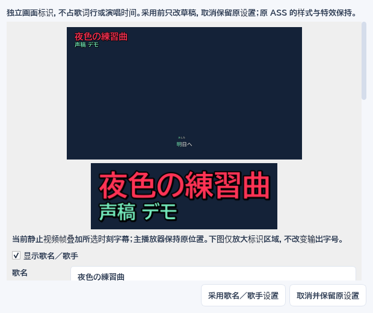

## 5. 导出作品

- `.sgproj`：继续编辑的工程，Ctrl＋S 保存；“作品”菜单可以另存和重新定位素材。保存时会携带已选字体资源，视频仍引用原文件。
- `.ass`：字幕交付，同时生成字体资源目录和字体说明。发送给他人时一起发送这些文件。声稿导出的 ASS 含可继续编辑的工程信息。
- `.mp4`：字幕写入画面。底部样片与导出按钮始终可见。先试压 12 秒，确认字体、注音、高亮及时间后，再压制全片。默认跟随原视频尺寸与帧率；CPU 为默认方式，显卡选项由本机实际探测决定。

只有音频也可导出 MP4：软件自动使用与预览一致的深色背景。

压制使用提交时的工程快照。可以取消，失败或取消不会把半成品当作成功文件。完成后可直接播放成品或打开所在目录，也可从任务记录找到成品；同一任务记录中也能恢复以前的转录建议。

最近作品只记录路径，不复制媒体；音量、播放速度和字幕显示偏好独立保存在本机，不进入作品和密钥配置。未采用的建议会继续保留；可明确放弃，再从任务记录恢复。

自动恢复、服务设置和任务记录位于当前用户的 `%APPDATA%/ShengaoKaraoke`。正式工程请主动保存，并保留媒体文件及工程附带的资源目录。旧版运行包和原始 Aegisub 不会被新程序覆盖。

0.31开发树仍读取第 1–14 版工程，新保存使用第 14 版，保留本歌词典、注音对应、罗马音规则与人工覆盖，以及固定点、详细颜色、时间来源、人声和待确认原文；新增歌曲标识、音节拆合记录和疑点决定。0.29.0 及更旧程序拒绝第 14 版，请另存副本；旧工程和旧运行包保留。个人词典单独保存在本机，不随工程分享。

## 按歌声重算本句音节

先在本句表格里填写正确的日语假名，再用“整句范围”圈住这一句实际歌声（0.1–60 秒）。点 **“按本句原声重算音节”**；已经为当前视频生成人声辅助时，按钮改为“按本句人声重算音节”并使用该音轨。程序在本机运行 TIFA，不上传、不使用 API 额度；本模型限非商业用途，完整 CC BY-NC-SA 4.0 许可随包提供。

整句头尾不动，人工改过的音节、锁定词组与人工词组头尾是固定位置，只重算中间部分。整句已确认时间时，按第 6 节的明确选择重新计算；生成时确认不变，采用后时间才恢复待确认。不必解除每个锁定词组，也不要为了重算改动原有假名。没有假名、范围过短或无法对应的人工特殊音节会明确提示，仍可直接手工划音。

点击 **“比较并审核歌声音节建议”**，比较每个音节的新旧起止，选择音节再点“试听这个音节（带前后音）”。勾选采用后才改变时间轴，一次采用可一步撤销，原文、分词和读音确认保留。模型只是把输入假名对到声音；它不会替你确认特殊唱法。音素缺失或无声区间保留原时间，不使用均分补装成声学结果。

短音、拖音、间隔与相同元音的内部分界会列出疑点，实际休止保留，不被固定 500ms 的连续划音规则自动填平。仍可在本句音节区手调、慢放和循环。采用来自外部 ASS 的音节建议会改用声稿样式显示新轴，并保留原 ASS，可撤销回去。

推理期间可以继续改歌词；旧建议与当前行不一致时不会覆盖人工修改。取消或失败保留原工程；结果可在“任务记录”恢复审核，保存工程也保留已采用的声音依据。片假名写法、罗马音和译文不会被对齐过程改写。

## 7. 处理划音中多余的空白

在校准页点 **检查空白…**。默认检查这一句，也可选多句、从这里到结尾或整首；选择当前原声／人声，或先准备人声辅助。长度上限只是最多分析多长的间隔，不是自动合并阈值，不上传音频、不消耗 API 额度。

结果逐项显示位置、两侧音节和原因。先点 **试听所选（带前后音）**，再决定保留、声音延续或人工延续；已确认、人工及已有声学边界受保护。声音不明确或原声只有伴奏持续时默认保留。需要直接改时，点 **去这处校准** 回到准确词组／音节。

**采用所选处理** 只延长前一高亮的尾部，下一音节起点不动。自动声音候选仍是待核对估算；明确人工延续记录为人工调整。原词与假名保持，时间和读音不会自动确认；Ctrl+Z 一步撤销。稍后可从任务记录继续审核。

新初稿默认保留间隔。“只按时长处理空白（高级）”和“按时长收拢（旧方式）”留在进阶区，默认关闭，不能识别真实休止。旧显式任务参数保持原义。没有空隙也不表示整句起音／尾音已准确。

分析后改了歌词、读音、时间或素材，旧结果仅供对照，需要重新检查。若替换了同一路径的视频，视频源菜单点 **重新载入当前源（保留字幕）**，重新准备播放和波形后再检查，不会改字幕轴。

工程格式 14，读取 1–14；0.29.0 及更旧程序不能打开第 14 版，保存时请另存副本。带人声工程的 `.assets` 目录也要保留。
