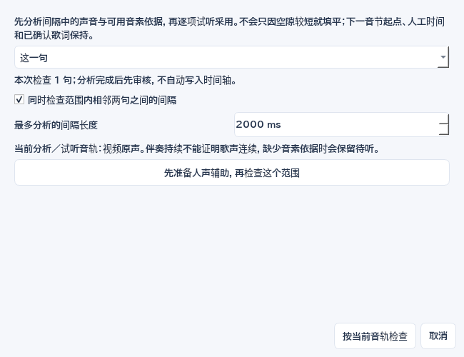
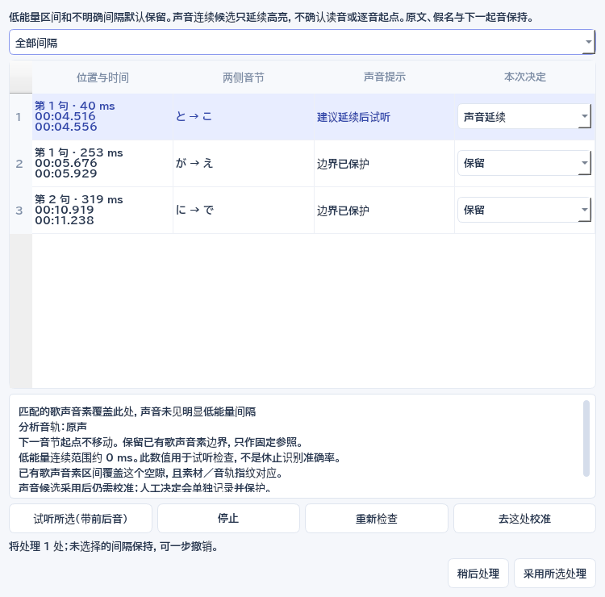

# 声稿 0.23.0：第一次制作日语卡拉 OK

完整解压运行包，双击 `shengao-karaoke.exe`。不需要安装 Python、FFmpeg 或 Aegisub。原始视频和歌词由你自己准备；软件内有不联网的合成练习素材，可以先走一遍流程。

顶部五步流程默认收起，点击“流程”展开或再次收起。每页的“下一步”会根据当前完成情况指向下一项操作：准备素材 → 生成初稿 → 检查假名 → 校准时间 → 调整样式 → 样片与导出。读音和时间分别确认；按钮悬停可查看作用。除校准页外默认优先显示大视频，小窗口的校准页优先显示完整音频时间轴，可用视图选择随时切换。

校准页展开流程时会收起重复的顶部进度提示。极小窗口中还会临时收起普通播放栏，保留分词、注音、时间轴及右侧试听控件；收起“流程”即可恢复播放栏。

## 1. 准备素材

欢迎页可以直接添加素材、打开最近作品，或用示例练习。把视频或音频拖进窗口，点击“粘贴原歌词”，每行一句。原歌词是字幕的依据；识别产生的额外空格不会覆盖原文。也可以拖入已有的 ASS、SRT、LRC 或声稿工程。

视频分析在后台运行，可以先准备歌词。整段音频缓存保存在本机，时间轴只绘制当前可见部分。视频预览与音频区之间的分隔条可以拖动；小窗口可通过顶栏“歌词列表”和视图选择切换重点。

在视频画面上滚轮，每格按 12.5% 缩放；也可选择百分比。放大后使用滚动条移动画面，双击视频恢复“适合窗口”。“放大视频”临时收起两侧面板，再点可恢复。缩放只影响预览。

### 没有原歌词时，先核对识别文字

导入音视频后，在“导入素材”或“生成字幕”点 **没有原歌词？先识别初稿…**。可选 ElevenLabs 或 Microsoft AI；有对应当前素材的识别结果时，默认本机复用。联网会上传音轨并使用额度，先在顶栏“服务设置”配置所选服务。未收到完整结果不会自动重试，先检查任务记录与服务账户再决定。

返回的文字进入独立的 **原文待确认** 草稿，尚未加入歌词或成品字幕。点 **继续核对识别原文…**，逐句试听并改字。列表显示识别参考范围；可带前后试听、慢放或循环。把光标放在两句之间，点 **在光标处拆句**；也可合并下一句、添加漏句或删除误识别。原始识别文字始终可对照，改字不改原始结果。只有拆分位置有字符时间证据时才沿用相应边界，否则标为估算，稍后仍需校轴。

准备初稿时会收拢日语字间的识别空格，英文空格保留；之后手工输入的真实空格不会自动删除。**撤销修改／重做修改** 和 Ctrl+Z／Ctrl+Y 可恢复本窗口的文字及拆合操作。**还原识别文字** 可回到初始候选，也能撤销。点 **稍后继续** 或关闭窗口，当前修改仍保留；保存 `.sgproj` 后在另一时段重开，可继续原文核对。任务记录能够恢复以前的识别或本地确认任务；恢复时不会覆盖已有歌词或正在修改的草稿。

确认所有文字后，点 **原文核对好了，加入歌词**。程序在本机按这些文字匹配原始识别、生成词组和估算音节，不再上传，也不调用 DeepSeek。文字保持你核对后的内容；读音和时间都仍是待确认状态。暂停时预览定位到首句，接着使用统一编辑区校对，也可以再选 DeepSeek 建议。加入歌词可一步撤销回原文草稿。

如果识别运行期间已经粘贴了正确原歌词，优先保留原文，仅存下识别供本地匹配；迟到结果不会把它换掉。素材版本变化、草稿又被修改、结果和已核对文字不一致时，不加入旧结果。新版识别结果记录素材文件指纹；旧转录只沿用已有来源记录，需要试听确认对应素材。原始识别留在工程，未确认草稿可明确放弃并撤销，不需要为改字重新识别。

### 原唱版和伴奏版共用字幕

视频下方的 **“添加伴奏版…”** 选择准备好的另一份视频或音频，软件先在后台读取，成功后才切换。以后直接点击 **“切到原唱版／切到伴奏版”**；右侧小箭头可更换任一版本文件，源文件丢失时也可重新定位。切换保留原文、分词、假名、罗马音、译文、全部演唱／留屏时间及确认与锁定状态，不调用转录。已有转录仍绑定原始文件，切到伴奏不会将旧转录当成新音轨的结果。

预览、波形、频谱和压制一起使用当前源；暂停切换会静音准备画面并恢复播放点与原音量。新文件损坏或取消时保留当前源；文件在读取过程中改变时拒绝切换。两版时长差异超过 300ms 或字幕超出新片尾时先提示检查，是否使用由你决定；不自动拉伸时间轴，实际剪辑和前奏仍需试听确认。

两个源的路径和当前选择随工程保存，可一步撤销／重做。分别切到所需版本再导出，默认成品名含“原唱版／伴奏版”，任务记录保留实际源。换源使用你已有的原唱／伴奏文件。

### 听不清唱词时，用人声辅助

音频区点击 **试听：原声**。首次在本机分离人声，会显示已完成的分段数；不上传素材，不使用 API 额度。CPU 处理可能需要数分钟，可以继续改歌词或点“取消任务”。模型和运行环境已内置，不需要自行安装。成功后按钮变为 **试听：人声**，频谱／波形一起切到人声；再点一次返回原声，再次使用复用缓存。右侧小箭头也可以直接选原声、人声或检查缓存。

切换保留播放点、慢放、循环、视频缩放和字幕轴。单播放器负责画面和所选试听音轨，避免两个播放器各自走时。分离可能留下伴奏或削弱尾音，务必来回对照原声。**人声辅助用于试听、看频谱和明确选择的本机声音分析**；联网转录和最终成片仍使用当前视频源。要做原唱／伴奏成片，请使用上一节的视频源切换。

保存工程时，人声 WAV 自动放在工程同名 `.assets/audio` 目录，发送工程时一起携带。重开默认原声，需要时点选人声；源视频切换也默认回原声。人声与生成它的素材指纹绑定，素材变化时重新检查并生成，不自动拉伸或套用旧人声。失败或取消保留原素材、原试听和人工修改，已成功的缓存可以复用。

## 2. 生成初稿

推荐点 **按步骤生成初稿…**，一次选好所需步骤。默认离线，在现有整句范围内生成可编辑粗稿；已有且对应当前素材的转录可本机复用。选择联网识别时使用 ElevenLabs 或 Microsoft AI，可另外勾选 DeepSeek 读音建议、ElevenLabs 文字对齐。对话框分别说明上传内容及额度使用，未选择的步骤会明确跳过。

流程依次准备转录、按原歌词匹配／分词、生成读音建议、文字对齐、歌声音节和准备审核，共六个阶段；未选择的阶段明确跳过。选择已有转录或联网识别时，默认勾选 **本机按歌声细分音节**。这一步使用内置 TIFA 和实际音频，无需密钥、不上传、不使用额度；模型限个人非商业使用。可选当前原声或已有且对应当前素材的人声辅助，不改变成片音轨。

歌声对齐以本次假名为约束，并不能证明该假名唱对。勾选微调句首句尾时，在粗轴附近寻找声音边界；额外分析范围受相邻句限制，保留已有重叠，避免短句混入下一句唱词。输入范围本身错误、配到另一个副歌或缺读音时，仍需先圈定正确范围。离线只给了等分范围时不会默认打开声学阶段。已有译文、已确认或人工读音分组保留；锁定、确认过时间或含人工时间的行不会进入整首自动初稿，可以使用本句编辑区的局部重算。

整批只加载一次歌声模型，每句有效结果立即保存。取消后继续只补缺失句子；已验证的数值缓存也能在重新建立流程时复用。审核表增加 **音节状态**：歌声候选、需手工、尚未处理，失败原因可直接查看。展开音节对照可以比较新旧边界、查看读音依据并逐音试听。无效音素或无声区间保留初稿，不用均分结果冒充声学边界；未选择声学处理时，内部音节仍可能是估算。

遇到需手工的行，点 **先手工修这一句**：其他建议先保存到任务记录，再进入该句统一编辑区。修好范围、读音后可以本句重算；暂存建议从任务记录恢复，已经手改或确认的内容不会被旧建议覆盖。候选不等于人工确认，采用后仍需试听；读音确认与时间确认分开，整次采用支持一步撤销。

每步完成后保存本机检查点。点 **查看／继续上次初稿流程…**，可查看各步骤、先审核部分初稿，或继续未完成步骤；任务记录也有继续入口。完成的步骤直接复用，不会重跑。上次未完整返回的联网步骤可能已经由服务端处理，先核对服务记录，再在对话框手动决定是否重试；程序不会自动重发此请求。取消或后台进程意外结束时，也会尽量保留已完成阶段；不存在的服务端响应无法由本机恢复。

保存并重开同一工程，在同一 Windows 用户下仍能找到上次流程。检查点存在本机用户数据目录 `draft-workflows`，不包含密钥，也不嵌入 `.sgproj`；只拷贝工程到另一台电脑不会带走这些检查点。恢复核对原素材与服务配置；素材、流程输入或配置不一致时停止并保留旧记录。工程中途手改、新确认或锁定的行，审核旧建议时保留当前内容，其余建议仍可继续审核。检查点损坏不会触发自动收费重试。

**单独运行某一步（进阶）** 中保留原有工具：

- 离线分词：按原歌词生成词组、假名、罗马音和演唱音节，时间属于估算。
- ElevenLabs / Microsoft AI：在“服务设置”中填写密钥，选择服务后转录、匹配原歌词。已经有转录结果时使用本地匹配，或只对需要的区间重新匹配。
- DeepSeek：为日语歌词补充或复核假名、罗马音和中文译文。先前转录会作为读音依据，特殊唱法仍需试听。

每次返回结果都先审核。查看当前值、建议值、依据和候选时段，试听后勾选需要采用的行。未勾选的内容不会被改写；任务期间被你修改或锁定的行也会保留。

### 重复副歌、漏句或配错段

已有转录或联网转录后的匹配会按原歌词整首顺序处理，并利用前后能确定位置的文字及人工位置约束重复段。已确认、手调和锁定的行只作前后文，内容保留；即使该句没有被识别，也不能让前面的歌词配到它后面。原歌词的空格、分词和已填写读音保持，不按识别空格拆出新词组。

审核中的 **整首顺序检查（匹配时）** 列出漏识别／缺唱候选、重复段位置待定、段落顺序不同、文字对应较弱，以及未分配转录／多唱候选。下拉选择疑点会定位表中对应句，**试听疑点** 带前后音播放，最多 12 秒；较长区间先听开头，再到主界面继续定位。转录中未分配文字忽略空格、标点和假名宽度差异，原始识别仍保留在工程／任务记录中。

没有足够对应的句子保留当前轴，不硬造一个匹配位置。重复候选可能有多个时段；选择后先试听，再勾选采用。候选不能跨越已保留的人工位置；超出自动文字前后文的备选会明确提示。分数只表示文字相似程度，不能证明唱法或演唱起止。漏识别可能由识别错误造成，不能直接称为实际缺唱，多余识别也不等于真的多唱。

**定位到主界面校对** 先把本次建议保存在任务记录，再进入该句整句范围、分词和假名编辑；当前工程不先应用建议。**限定正确时段重匹配** 同样先暂存，再让你试听并填写正确区间，只复用已有转录匹配这一句，不重新上传或提交付费识别。它是明确的局部重做，可替换该范围内原有手调时间，但仍先审核；锁定内容必须先解除。取消范围选择时原内容及暂存结果保留。采用后可一步撤销，其他歌词保持。

该清单记录匹配阶段的判断，后续手工或歌声调整不会自动把旧记录改成新结论。整首分阶段流程及任务恢复保留这份依据；旧版已完成任务保持原检查点，不会为了新增检查自动重跑或收费。整首结果不理想时，可明确使用“使用已有转录，重新匹配”在本机生成新候选。

新初稿默认保留原始间隔。校准页 **检查空白…** 根据声音与保留的音素依据提出候选，先试听再采用；下一起音和人工边界保持。旧的按时长收拢功能移入进阶区，独立开关默认关闭；固定阈值不能识别真实休止。完整步骤见第 7 节。

密钥加密保存在当前 Windows 用户的数据目录，不进入工程。保存设置不会发起收费请求。任务超时或取消时，服务端可能已经接收请求；先查看任务记录和返回结果，再决定是否重新提交。

## 3. 对齐与校对

本句编辑把原文、词组、假名、演唱音节和起止时间放在同一区域。先听整句，再改分词、读音和边界；右侧可以滚动，底部确认按钮始终保留。原文如何组合，与某个假名何时亮起，是两个层次。

视频上方的 **① 分词、② 注音、③ 调时间** 会定位到同一个编辑区。尾音细听仍提供单独放大的精细工具。

点击 **① 分词**，在原文某字前增加分界，点击已有分界合并；也可先按词典切分或合为整句。同一个预览中可多次调整，应用前列出需要重估的词组。相同跨度的人工读音和音节保留，合并保留原有音节与实际间隔，只有新切开的词组需要重估。原文和真实空格保持，不建立纯空白词组。先应用或取消预览，再保存、切句或继续编辑；一次应用可一步撤销。

未匹配、没有词组时，先点 **整句范围**，在起止框确定实际唱词范围并应用、试听，再分词。没有假名也能先定范围。修改已有整句头尾不会自动拉伸所有内部边界；整段偏移使用下方整体校轴工具。

点击原文词组或表格原文，直接在假名格中填写实际读音。也可点 **② 注音／直接改假名**，不打开模态窗口。原文汉字保持，罗马音跟随读音变化；只重估变动词组的内部音节，其他人工数据保留。展开 **罗马音与中文译文（可选）**，显示罗马音列或手工修改译文。词组锁定不会阻止编辑其他词组；涉及锁定边界的修改会整体拒绝。

点击演唱音节选中并定位，右键直接试听；下方时间框、原文词组、表格和原版时间轴同步。点击音节会退出整段拖动，以便修改当前边界。视频下方 **定位唱词** 按当前播放点选中对应句和音节，不将播放点跳回开头，也不修改时间；演唱重叠时保留当前句，间奏选择最近句。更改分词后，仍选中原来对应的词组与音节。

旧工程有假名却没有细音节时，使用 **补全音节**，先看预览，再应用。它按现有假名与词组范围均分时间，属于估算，不是声学识别。原假名（含片假名写法）、罗马音、词组起止、已有人工音节保留；锁定、缺少有效假名或范围过短的词组会列明未处理数量。补充后需要试听并重新确认时间，原读音确认保持。外部复杂 ASS 改用声稿排版时，预览会提前说明，原 ASS 仍保存在工程中。

后台返回建议时，先提交正在输入的有效内容；失去窗口焦点也不会遗漏编辑缓冲。建议仍需审核，已修改的行会保留当前值；后台保存转录不会丢弃未应用的分词预览。

### 看懂当前时间是怎么来的

选中词组或音节后，起止框上方直接显示 **字符／单词时间参考、估算音节、歌声候选或人工调整**。字／词参考提供外部范围，内部假名仍可能均分。整体移动后的估算仍是估算；“已保护”只防止自动覆盖，是否确认另看对应复选框。

点 **来源／提示**，逐层比较原始依据和当前范围，筛选估算、歌声候选、人工调整或未确认提示。带前后音试听，点 **去校准所选** 回到对应音节，起止框与时间轴同步定位。来源窗口本身只读；打开前的有效输入先按原流程提交，分词预览须先应用或取消。短音、长音、固定规则延尾、旧声音依据与当前假名不一致等仅作为试听提示，不自动修正或冒充模型准确率。

手调边界后记录人工调整，确认时间仍保留原始来源；修改、保存和撤销一起恢复。旧工程没有记录字／词粒度时不猜测；旧 TIFA 记录只有保留的音素区间能对应当前边界时，才只读说明其声音依据。改读音或边界后提示复核，不重复调用服务。

整体错位时，展开 **整体错位（本句／多句／整首）**，选择本句、选中多句、从这里到结尾或整首。Ctrl 点选、Shift 连选；偏移、移到播放点、拖动使用同一范围。点 **整体提前／延后…** 先预览、试听，再一次应用。相对时间和读音保留；时间需要重新检查，读音确认保持。

开启 **“拖动整句”** 后，同一个修改范围也用于拖动；即使旧时间不在当前视野，也能把本句抓到鼠标位置。Alt＋左键拖动可临时移动。拖动显示旧位置、目标和偏移量；到边缘会连续平移视野，松开才提交，Esc 取消，Ctrl＋Z 一步撤销。锁定冲突会明确指出，不会只移动范围中的一部分。

展开 **“逐渐偏移／配错段／整首概览”**：对开头准确、后面越来越偏的轴，选择至少两个原字幕位置及实际歌声位置，可试听并用播放点填写；必要时加入更多位置，位置之间逐段校正，两端以外只平移。副歌配错段时指定正确时间区间，使用已有转录在本地重新匹配，再审核采用；范围以外的内容保持。整首概览只移动视野。单句头尾有误可用“整句范围”；需要重估整句内部时间时，进阶单独分词窗口仍可使用。

在 **微调、空白与字幕留屏** 中展开 **本句字幕出现／消失时间**，可独立改本句的留屏范围，必须覆盖演唱时间；也可将修改范围恢复为自动显示。整首校轴同步移动画面显示时间；局部修正保留人工留屏并确保覆盖演唱。新出现的演唱重叠是检查提示，允许保留实际合唱。

“找播放点”只把视野移到当前播放位置，“定位本句”找回整句及上句衔接，“放大所选”看清当前音节。这些按钮不会改变时间。

旧初稿有多余空白时，优先用 **检查空白…** 逐项试听。进阶区 **只按时长处理空白（高级）** 仍可选范围与阈值；该旧方式只按时长处理，不能确认歌声连续。

精确对齐的缓存保留原始字符时间，改变连续划音选项时会在本机重新计算，避免为同一份缓存再次请求接口。

时间轴上方的青色轨显示上一句，紫色轨显示下一句，与本句频谱共用同一刻度。边界标记分别代表上句唱完、下句开唱；橙色提示演唱重叠。单击邻句音节直接校准该音节，右键试听；有空间时也显示“改上句／改下句”和衔接试听按钮。小窗口合并参照说明、收起按钮，仍保留音节轨和完整时间轴。演唱重叠可能是真实合唱，需试听判断；与双行歌词有意同时留屏不同。

- 词组 / 音节模式：左键选择或拖边界，右键试听，中键定位视频。拖动时同步显示临时范围，松开才提交，一步撤销。
- 整句模式：左键设置开始，右键设置结束。单独调整整句不会重新分词或改写原歌词。
- 拖上方刻度平移，滚轮平移，Ctrl＋滚轮缩放；启用吸附后可对齐关键帧、邻句和当前播放位置，Shift 暂时关闭吸附。
- Ctrl＋拖动内部边界可移动后续边界。边界受前后顺序约束，不能把音节拖成负时长。
- 在“微调、空白与字幕留屏 → 微调与空白时间”中试听间隙，选择保留、并入前一音节或后一音节；整次操作可撤销。
- 假名直接在表中修改，罗马音会跟随更新；也可手工改罗马音。原文中的汉字保持原样。

时间轴上方 **“频谱／波形”** 直接切换原版显示，保留当前时间位置和选择，并记住偏好。“显示设置”可选择波形平均值、质量、频率曲线与增益。原版 Icy Blue / Green 配色、刻度、句界、音节线和歌词标记用于辅助找起音。自动时间属于初稿，最终以实际演唱和人工确认结果为准。

音频区右侧三个竖滑条从左到右是 **时宽、高度、音量**。时宽往上拖会放大时间，便于抓边界；高度调整波形／频谱的显示增益，让弱音更明显；音量只调整试听声音。前两个双击恢复默认。三个控件均不改变素材、字幕时间或导出音量。

尾音难听清时点 **“尾音细听”**，默认选中最后一音。先点“带前音试听”，再用“仅听当前音”对照，支持 0.5×、0.75× 保留音高慢放和循环。频谱／波形、显示增益与“放大当前音”帮助观察弱音；“突出尾音辅音（减弱低频）”只对短片段试听做频带增强，可随时关闭对照原声，不会分离人声或自动判断唱了哪个音。伴奏也会影响显示的混合声强。

在细听窗口拖边界、改开始／结束或用 10ms 按钮微调；必要时修正一个音节的假名，例如“て”“す”“きょ”。整词读音在本句表格修改，原歌词错误则用“编辑原歌词”。点“保存本句修改”才写回工程，整次可一步撤销；取消保留原值。关闭窗口后恢复原来的试听速度与循环设置。

时间框显示“分:秒.毫秒”，支持 `01:23.450`、`83.45` 秒或 `83450ms`。也可用当前播放位置直接设置起止。

**本次确认** 选择底部按钮确认时间或读音，所有字段始终可达；点读音编辑时自动选择读音，点时间框或音节时选择时间。两项也可分别勾选。底部按钮完成后寻找下一句对应待确认内容；Ctrl＋J 找下一疑点。AI 初稿不会自动成为人工确认，锁定仍保护自动处理。Ctrl＋Z／Ctrl＋Y 撤销与重做。

时间轴获得焦点时采用 Aegisub 3.5.0 Audio 默认键位：R 听整句，S／空格听所选，B 试听所选或停止，Q／W 听前后 500ms，E／D 听开头结尾 500ms，T 听到媒体末尾，H 停止。Z／X 或方向键切换音节；整句模式切换句子，A／F 平移 128 像素。C／V 增加 100ms 引入／350ms 引出。小键盘 −／+ 微调 10ms；Shift 加小键盘 −／+ 同时移动后续内部边界。音节模式不通过长度键改变整句头尾。

Enter／G 提交后**按原稿顺序**进入下一句；Shift+G 在整句模式将下句重置为 3 秒，音节模式保留下句原时间。“显示设置 → 查看 Aegisub 打轴快捷键”可查看完整列表和提交选项。Medusa 小键盘默认关闭，可在设置中启用，或时间轴聚焦时按 Ctrl+小键盘 * 开关。开启后小键盘 5 试听、8 停止、0／2 切换、4／6 改起点、7／9 改长度，在主窗口其他编辑框也生效。关闭时输入假名和数字可正常使用。F6 试听本句、Ctrl+Enter 跳到待确认句仍可使用。

## 4. 字幕样式

点击 **“应用双行接唱 · 日式注音”**，使用上左、下右交替的卡拉 OK 模板。默认唱到本句约 50% 时提示下一句，最多提前 3 秒；上句从下句出现起保留约 3 秒，正在演唱的内容不会提前消失。短句会缩短留屏给新句让位，间奏会清屏。超过两句实际同时演唱时，临时增加字幕行并提示检查重复歌词匹配。

双行排版按邻近的显示内容计算，不再用远处异常重叠歌词挤走当前句；过密重叠会临时缩小以留在画面内，请先校对重叠时间。暂停时若播放位置没有字幕，切换显示或应用模板会定位到本句，方便立即查看效果。

展开“调整接唱速度与光晕”可改变提示进度、保留时间、提前量和光晕。“本句显示”与“演唱”分别显示画面留屏时间和音节轴时间。提前出现的句子保持未演唱颜色，高亮从原来的音节起点开始。默认模板隐藏罗马音和译文，需要时可重新勾选。仍可切回“逐句显示”。

正文保留原歌词真实空格；分词不会额外撑开正文。假名优先贴在对应汉字词组上方，例如“お相手は”只在“相手”上方显示“あいて”。读音取自你已填写或采用的结果，不会在排版时重新猜读音；如果汉字与送假名无法唯一对应，保留整词注音，需试听核对。熟字训等整体读音保持一组。

用当前歌词预览模板，分别控制假名、罗马音和译文的显示与字号；原文与罗马音共用主字体，假名和译文可以单独选择字体。常规文字、高亮、描边颜色在样式中统一设置。

内置推荐包含 **Noto Serif CJK JP Black 特粗明朝正文＋BIZ UDPGothic Bold 粗假名**的日式接唱，以及更简洁的粗黑模板。原有常规黑体、明朝和本地字体仍可选择。模板只改变样式，不改歌词、读音或演唱时间；现有作品不会自动换字体。实际字体与字重随工程保存，并在 ASS／视频压制中保持。字体授权随软件提供。检查会提示缺字、丢失的字体引用、长行缩小和超出安全区的内容。

眼睛按钮（Ctrl＋Shift＋P）显示或隐藏字幕，方便与原画面对比。

导入复杂 ASS 时默认保留原样式与标签。选择声稿模板后才改用新的注音排版，原始 ASS 仍保存在工程中。部分外部特效不能直接转换成逐词读音，导入后应检查实际预览。

## 5. 导出作品

- `.sgproj`：继续编辑的工程，Ctrl＋S 保存；“作品”菜单可以另存和重新定位素材。保存时会携带已选字体资源，视频仍引用原文件。
- `.ass`：字幕交付，同时生成字体资源目录和字体说明。发送给他人时一起发送这些文件。声稿导出的 ASS 含可继续编辑的工程信息。
- `.mp4`：字幕写入画面。底部样片与导出按钮始终可见。先试压 12 秒，确认字体、注音、高亮及时间后，再压制全片。默认跟随原视频尺寸与帧率；CPU 为默认方式，显卡选项由本机实际探测决定。

只有音频也可导出 MP4：软件自动使用与预览一致的深色背景。

压制使用提交时的工程快照。可以取消，失败或取消不会把半成品当作成功文件。完成后可直接播放成品或打开所在目录，也可从任务记录找到成品；同一任务记录中也能恢复以前的转录建议。

最近作品只记录路径，不复制媒体；音量、播放速度和字幕显示偏好独立保存在本机，不进入作品和密钥配置。未采用的建议会继续保留；可明确放弃，再从任务记录恢复。

自动恢复、服务设置和任务记录位于当前用户的 `%APPDATA%/ShengaoKaraoke`。正式工程请主动保存，并保留媒体文件及工程附带的资源目录。旧版运行包和原始 Aegisub 不会被新程序覆盖。

0.22.0 能打开第 1 至 9 版工程，新保存使用第 9 版，保留时间来源与变更、声音依据、人声辅助、待确认原文及素材指纹。0.21.0 和更旧程序会拒绝第 9 版，请另存副本并用新版继续。旧工程和旧运行包保留。

## 按歌声重算本句音节

先在本句表格里填写正确的日语假名，再用“整句范围”圈住这一句实际歌声（0.1–60 秒）。点 **“按本句原声重算音节”**；已经为当前视频生成人声辅助时，按钮改为“按本句人声重算音节”并使用该音轨。程序在本机运行 TIFA，不上传、不使用 API 额度；本模型限非商业用途，完整 CC BY-NC-SA 4.0 许可随包提供。

整句头尾不动，人工改过的音节、锁定词组与人工词组头尾是固定位置，只重算中间部分。整句已确认时间时，先解除本句确认才可重新计算；不必解除每个锁定词组。没有假名、范围过短或无法对应的人工特殊音节会明确提示，仍可直接手工划音。

点击 **“比较并审核歌声音节建议”**，比较每个音节的新旧起止，选择音节再点“试听这个音节（带前后音）”。勾选采用后才改变时间轴，一次采用可一步撤销，原文、分词和读音确认保留。模型只是把输入假名对到声音；它不会替你确认特殊唱法。音素缺失或无声区间保留原时间，不使用均分补装成声学结果。

短音、拖音、间隔与相同元音的内部分界会列出疑点，实际休止保留，不被固定 500ms 的连续划音规则自动填平。仍可在本句音节区手调、慢放和循环。采用来自外部 ASS 的音节建议会改用声稿样式显示新轴，并保留原 ASS，可撤销回去。

推理期间可以继续改歌词；旧建议与当前行不一致时不会覆盖人工修改。取消或失败保留原工程；结果可在“任务记录”恢复审核，保存工程也保留已采用的声音依据。片假名写法、罗马音和译文不会被对齐过程改写。

## 7. 处理划音中多余的空白

在校准页点 **检查空白…**。默认检查这一句，也可选多句、从这里到结尾或整首；选择当前原声／人声，或先准备人声辅助。长度上限只是最多分析多长的间隔，不是自动合并阈值，不上传音频、不消耗 API 额度。

结果逐项显示位置、两侧音节和原因。先点 **试听所选（带前后音）**，再决定保留、声音延续或人工延续；已确认、人工及已有声学边界受保护。声音不明确或原声只有伴奏持续时默认保留。需要直接改时，点 **去这处校准** 回到准确词组／音节。

**采用所选处理** 只延长前一高亮的尾部，下一音节起点不动。自动声音候选仍是待核对估算；明确人工延续记录为人工调整。原词与假名保持，时间和读音不会自动确认；Ctrl+Z 一步撤销。稍后可从任务记录继续审核。

新初稿默认保留间隔。“只按时长处理空白（高级）”和“按时长收拢（旧方式）”留在进阶区，默认关闭，不能识别真实休止。旧显式任务参数保持原义。没有空隙也不表示整句起音／尾音已准确。

分析后改了歌词、读音、时间或素材，旧结果仅供对照，需要重新检查。若替换了同一路径的视频，视频源菜单点 **重新载入当前源（保留字幕）**，重新准备播放和波形后再检查，不会改字幕轴。

本版工程格式 9，读取 1–9；0.21.0 及更旧程序不能打开第 9 版，保存时请另存副本。带人声工程的 `.assets` 目录也要保留。
