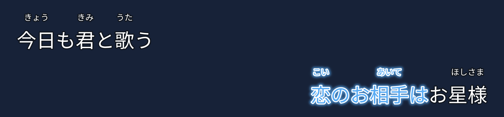

# 声稿 0.10.0：双行接唱、汉字注音与邻句参照

本轮按用户提供的双行日式卡拉 OK 参考图改进，使用自己的离屏静音测试实例，不使用 Computer Use，不读取用户密钥、不发起真实付费 API 调用。原始 `E:/transcribe/Aegisub-3.5.0` 未改动。

## 行为

- “双行接唱 · 日式注音”模板：上左、下右交替；默认本句进度 50% 时提示下句，最多提前 3 秒，上句从下句出现后保留约 3 秒。短句给新句让位，间奏清屏，持续演唱的句子不会提前消失。
- 显示窗口独立于实际演唱／音节时间。提前出现的歌词不提前高亮；显示窗口、接唱参数、字体与样式一起保存到工程和含工程数据的 ASS。
- 模板带演唱蓝色光晕与白色描边过渡，可调整光晕，亦可改回逐句显示。默认模板隐藏罗马音与译文，仍可重新启用。
- 假名以已采用的读音为准，利用送假名定位汉字词组，例如“お相手は”仅在“相手”上方放“あいて”。无法唯一对应时保留整词注音并提示核对；熟字训保持整体，不猜逐字读音。
- 修复正文宽度使用 em 字号、ASS 实际渲染使用 Win ascent/descent 尺度的偏差；同时移除假名撑宽正文的逻辑。保留原歌词的半角／全角空格。依据：[libass 0.17.5 字体处理源码](https://github.com/libass/libass/blob/0.17.5/libass/ass_font.c)。
- 时间轴新增上一句音节参照轨、唱完位置和实际重叠毫秒数；全部模式绘制上句音节边界、下句开始线。单击上句音节进入对应音节校准，右键试听，支持连续试听衔接和撤销。

## 验证

- 完整回归 **200 项通过**：`build/desktop-tests.xml`、`build/desktop-tests.log`。覆盖两种内置字体、多个字号、有无原始空格的真实 ASS 图像与连续原文逐字位置对照；假名锚点、接唱时序、短句／间奏／多句同时演唱、邻句跳转、改轴与撤销、紧凑窗口、保存重开。
- 双行＋假名＋光晕在 libass 实时预览与 FFmpeg 生成画面中的位置一致，编码色度采样只容许邻近像素的低透明度光晕边缘差异。
- 原有时间轴基线正常及 150% 缩放各 6 组，与原版绘图／频谱参照 **0 不同像素**。新增参照轨另有交互与布局回归，基线对照不代表已逐像素复刻所有新增功能。
- 开发实例完整验收 **50 项通过**，含独立后台任务、真实音视频输出、邻句轨与双行预览。记录：`tmp/desktop-v010-final/report.json`。
- 正式运行包正常及 **150% 缩放各 50 项隔离验收通过**；全部 **187 个 PE 二进制依赖完整**。日志：`build/desktop-package-test.log`、`build/desktop-package-dpi150-test.log`、`build/desktop-dependencies.json`。

[8 秒合成音布局演示](examples/shengao010-dual-row-demo.mp4)；该素材只用于展示提前显示、演唱高亮与留屏，不是对真实歌曲的声学对齐结果。

参考图只提供了画面，不能直接测得视频的完整逐帧时序。50% 与约 3 秒按用户描述实现为可调参数，并对短句、间奏、同时演唱做避让。读音正确性仍需要结合歌声人工确认。

旧版运行包保留，源代码与运行包按 0.10.0 单独归档，校验值见 `dist/SHA256SUMS-0.10.0.txt`。
