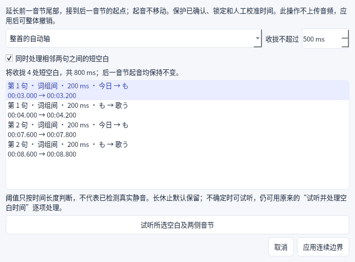

# 声稿 0.10.1：修复自动分轴的多余空白时间

用户已明确指出问题发生在自动生成的时间轴，而非字幕画面字距。本轮修复实际分轴数据；原歌词与音频文件不变。

## 修复

- 界面提交自动分轴任务时原先固定发送 `gap_ms=0`，使短空白处理失效。现在“连续划音”默认开启，生成、匹配及精确对齐初稿按 500ms 阈值收拢短空白，可关闭并记住偏好。
- 处理范围包括词组间、演唱音节内部，以及相邻两句之间。采用延长前一音节尾部的方式，所有后续起音保持原位；连续边界可像正常共用边界一样拖动，不再留下单独的空白段。
- 已确认、锁定、人工校准及匹配失败内容受到保护；长于阈值的休止不自动收拢。读音复核任务不因此改轴。副歌候选内部的短空白也按同一规则处理。
- “时间对齐 → 收拢已有自动轴的空白…”提供当前句／整首范围、10–2000ms 阈值、是否处理句间空白、处理明细与试听；应用后一步撤销，重做正常。仅在本地处理，不调用 API。
- 精确对齐缓存保留原始字符时间。切换选项时在本地重放原始时间并重新整理；缓存键不因整理偏好变化而改变，缓存文件保持不变，避免重复调用接口。
- 阈值是按时间长度判断，不能证明该段是真实静音。此功能延续高亮尾部，不剪辑音频；特殊停顿仍可通过原有停顿工具逐项处理。

## 验证

- 完整回归 **224 项通过**，含新增连续分轴、手工保护、原文与起音不变、词组／音节／句间边界、长休止、重复副歌候选、离线重新分词、缓存重复使用、清理预览与真实命令应用、整体撤销与重做。记录：`build/desktop-tests.xml`、`build/desktop-tests.log`。
- 开发实例 **55 项离屏验收通过**，含完整播放、后台任务、真实视频编码、接唱模板、邻句参照、清理命令与恢复状态。记录：`tmp/desktop-v0101-final/report.json`。
- 正常及150%缩放各6组原版时间轴／频谱像素基线通过，均0不同像素。此次未改动原生绘图模块。
- 正式运行包正常及150%缩放 **各55项离屏验收通过**；**187个二进制依赖完整**，未发现缺失导入。记录：`build/desktop-package-test.log`、`build/desktop-package-dpi150-test.log`、`build/desktop-dependencies.json`。

全部验证使用手工／合成素材、自己的静音离屏实例和模拟接口；未使用 Computer Use、用户密钥或真实收费 API。原始 Aegisub 与旧版运行包保留。

运行包与完整源码按0.10.1单独归档，校验值见 `dist/SHA256SUMS-0.10.1.txt`。
