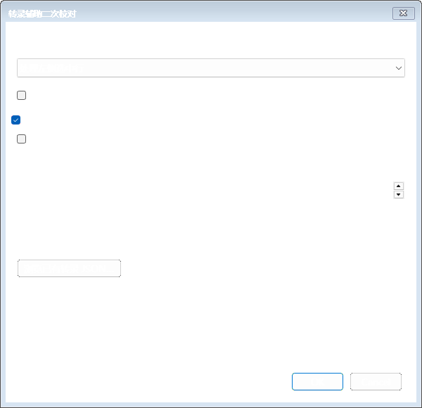
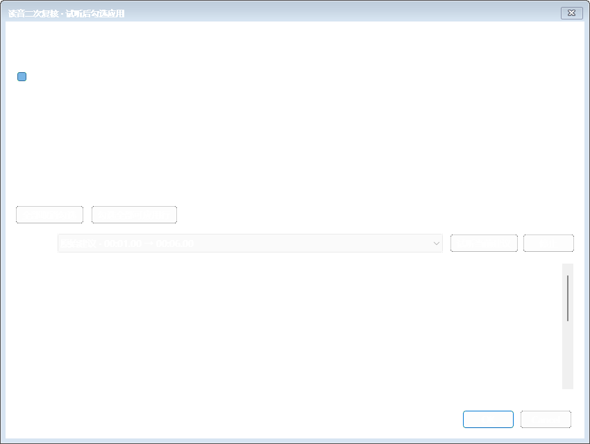

# 0.6.0 人工校轴与转录辅助读音验收

本轮根据实际问题调整原生软件：去除词条中人为增加的空格，让开始／结束更容易拖动，以转录辅助日语汉字读音复核，并把人工二次校对的常用操作集中到首屏。原始 Aegisub 目录和既有发行版本保留。

## 要求与对应实现

| 要求 | 现在的行为 | 验证依据 |
| --- | --- | --- |
| 词间不应凭空出现空格 | 按真实字宽绘制原歌词，不插入间隔字或等宽字格；停顿不形成空白词格，原文空格保留 | 真实分词控件精确文本、日文词内点击、合并／取消／撤销，以及 `karaoke-single-boundaries.png` |
| 起点和终点容易拖动 | 放大手柄及命中范围，卡拉 OK 模式可直接拖整行两端；禁止越过内部边界；松开即提交，每次独立撤销 | 真实时间控制器的两端拖动、松手、撤销及 10ms 模型／可见标记一致性 |
| 便于人工二次校轴 | 整行／逐词起止输入，10／50／100ms 微调、共享边界联动、边界试听、定位缩放、确认下一待校准行；F6、Ctrl+Enter、Esc | 真实控件事件、播放状态、范围进入视区、确认导航和撤销 |
| 识别产生的短空隙 | 可收拢自动词间短间隔，默认 120ms，0 为关闭；长停顿、人工时间、已确认时间保持；原转录缓存不改 | 短／长间隔、手工音节、已确认、锁定及建议与原始结果隔离测试 |
| 日语汉字注音不对 | 当前媒体转录＋原文分组＋词典＋上下句，离线或 DeepSeek 二次复核；汉字不能冒充假名；读音与时间保护分开 | 汉字多音、错误假名修正、缺罗马音、助词读音、错误副歌、跨词识别和模拟 LLM 契约 |
| 修正依据可核查 | 显示原／建议读音、罗马音变化、对应转录、词典及 LLM 理由；先试听、手动勾选；取消不改文档 | 原生审核窗口、应用／取消、ASS 保存重开及 `reading-evidence.png` |
| 减少操作负担 | 校轴首屏放置微调、试听、确认和二次分析；自动工具折叠；播放区分行适应窄窗口；换行自动定位 | 四阶段与窄窗口真实原生渲染、首屏控件可见性 |
| 完整交付 | 独立 Windows 运行包、对应源码、说明和授权；现有工程及加密设置继续使用 | 隔离运行包测试、归档校验及源码／运行文件一致性检查 |

## 修复的问题

- 去掉人工填充字符后，点击位置按实际字宽映射，不再因隐藏空段而拆错日文字符；纯空白行和词首／词尾点击安全处理。
- 带假名的 `|!`、`#` 标记在界面中显示为读音；单击选音节、双击试听，结构编辑通过注音页进行，避免拆坏原词。
- 拖动标记和实际 ASS 时间统一到 10ms，防止显示与保存偏差；关闭自动提交后，拖动松手仍保存。
- 调整时间保留原 ASS 样式；同一文字位置的多项样式不会覆盖。未分词的普通歌词不会因修改行时间而插入零时长卡拉 OK 标签。
- 时间输入与注音草稿共同保存；后台结果避开未提交草稿，关闭可以保存／放弃／取消，换阶段保留编辑。停止试听会清除循环定时器。
- “时间已确认”允许继续复核读音，同时保护原词边界；明确手改的假名／罗马音单独记录来源，默认保留。旧版来源不明的读音提供保留选项。
- 自动注音保留时间真实来源，估算边界不再被误标为已映射；读音未变的手工演唱音节保留，改读音后的新音节标为估算。
- 自动查找转录限定当前媒体，新任务核对文件大小和修改时间；旧记录提示版本未知，替换后的媒体记录跳过。
- DeepSeek 分批完成结果缓存，后续失败保留成功批次并明确标注部分完成；没有自动重试付费请求。复核结果可从任务记录恢复。
- 修复适配脚本重复添加 Meson 源文件引发不必要全量配置的问题，连续运行保持源列表不变。

## 复现与证据

当前源码已通过后台 78 项测试、C++ 411 项测试（43 组）和 LuaJIT，正式完整运行包通过原生集成 274 个检查点及隔离运行包测试。原生实测包括把“歌う”的错误注音“かう”结合定时转录改为“うたう”，先审核再写入真实 ASS，保持已确认时间，并保存／重开验证注音来源和复核依据。测试使用合成素材，不代表对真实歌曲的识别准确率。

后台：`python -m pytest backend/tests -q`，覆盖读音候选、保护规则、时间与分词、匹配、接口错误及导出。

原生：`python scripts/test-native.py`，运行 C++ 和 LuaJIT；`python scripts/test-native-integration.py`，运行真正的窗口、wxProcess、时间控制器、审核和 ASS 保存／重开。测试入口只操作自己的隔离实例，以合成音视频和独立配置运行，不使用桌面输入自动化。

运行包：`python scripts/test-package.py`，清除开发 PATH、Python 环境与 API 环境变量，检查离线词典、转录辅助读音、加密配置、四种导出、FFmpeg 渲染／提取、文件摘要和独立目录安装。`python scripts/check-release.py` 检查完整 ZIP CRC、唯一条目、源码与运行文件一致性、DLL 闭包和 SHA256。

开发机的执行日志保存在 `build/backend-v06-test.log`、`build/native-v06-unit-test.log`、`build/native-v06-pretest-final.log`；正式完整包的原生与运行包检查写入 `build/native-v06-package-test.log`、`build/package-v06-test.log`，归档证据在 `build/archive-check.json`。这些临时构建日志不装入运行包；可用上述命令复现。

正式运行包的原生证据目录是 `tmp/native-integration-日语-u01b4ggd`，隔离运行包证据目录是 `tmp/package-test-xg8uwytt`。最后整理的使用说明和源码不会改变已测的原生程序及后台二进制，另以文件摘要核对一致性。

## 已知限制

转录和文本匹配得到粗轴，文字相似度不是声学置信度。新生成的演唱音节边界需要试听校准；收拢短间隔也不等于证明中间没有静音。

离线模式只在识别明确给出假名且时间覆盖适合时提出转录读音候选。转录仍为汉字时，不知道实际发音；DeepSeek 根据文字上下文给建议，不直接听音频。特殊唱法、当て字和识别错误需人工判断。读音建议全部默认不勾选。

没有上传用户歌曲、读取用户密钥或请求真实付费 API；测试使用本地模拟 HTTP 和合成音频，不能证明某首歌的真实识别准确率或当前账号模型权限。没有使用 Computer Use。慢放 0.5×／0.75× 会变调；成品 ASS 默认 1920×1080。
