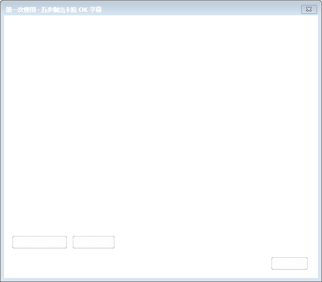
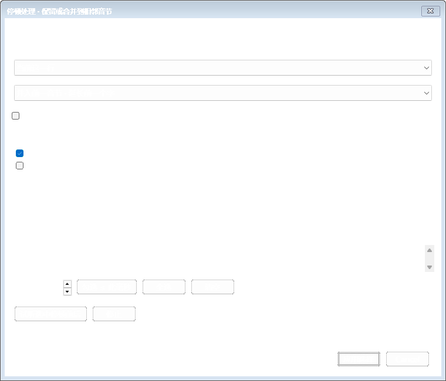

# 0.7.0 易用性与停顿处理

本轮重点是让首次使用者能理解制作顺序，并能主动决定卡拉 OK 停顿怎样分配。没有新增云端服务，既有原歌词匹配、日语注音和人工校准功能继续使用。

## 要求及结果

| 要求 | 实现与验证 |
| --- | --- |
| 第一次使用能看懂 | 中央“下一步”根据媒体、歌词、分词、音节、待审核任务和校准状态改变；空歌词列表说明导入方法。实际空工程启动并渲染，验证先添加媒体。 |
| 一处准备素材 | 导入页集中添加媒体、粘贴歌词，联网／离线制作并排；复用结果及工程导入折叠。首次制作说明不要求 LRC。 |
| 随时可查的说明与练习 | 右上“新手指南”提供五步流程、快捷键和离线示例。测试实际打开示例 JSON 与合成音频，无 API；打开其他工程前沿用保存／取消检查，取消不会误报示例已载入。 |
| 引导不重复改已完成内容 | “下一步”生成初稿只处理未完成行，结果仍需审核；已锁定或已确认的行不自动重做。标点与空格不会让引导反复要求拆音节，处理期间保留当前工作区。 |
| 停顿可选是否合并 | 提供保留、并入前一音节、并入后一音节，默认保留时间；默认只预勾选 ≤120ms 的内部短停顿，长停顿需主动选。覆盖词间及假名音节内部。 |
| 处理前能判断影响 | 停顿窗口列出时间、时长及相邻文字，支持当前／所选／全部范围、阈值筛选、全选、清空、边界试听和实际修改边界预览；行首／行尾空白单独启用，锁定内容跳过并显示数量。 |
| 实际影响打 K 和成品 | 修改真实音节时间，保留原歌词、读音、分组、整行起止、样式及未选停顿；修改后取消时间确认。真实控件测试合并／取消／保留／撤销／保存重开，后台分别导出可编辑与成品 ASS，验证仅去掉所选空段。 |
| 整体界面更易用 | 校轴首屏显示停顿数、微调、试听、确认下一行；显示时间确认进度。制作视图／专注打轴／放大预览分别适合并行制作、打 K、看清注音成品。验证普通及窄窗口。 |
| 分清应用和保存 | 底部“应用本行修改”与顶栏“保存工程”分开命名，并提示 Ctrl+S 保存文件。预览及导出前统一处理时间和注音草稿。 |
| 完整交付 | 独立 Windows 包、快速开始、使用说明、源码和授权；旧版本与原始 Aegisub 目录保留。 |

## 修复与保护

- 新建工程空白行不再触发正式停顿数据的校验异常；空状态显示“从这里开始”，不把空行计入字幕进度。
- 停顿可真正并入相邻音节，避免仅在词条上隐藏空段却保留原打 K 间隔。词内假名时间与跨词边界一起保持合法，整行范围不变。
- 保留／取消不写入工程；应用只处理勾选项，批次统一撤销。锁定行／词受到保护，明确的人工停顿修改可处理已确认时间，并要求重新确认。
- 已完成词组不会被“下一步”重新自动分词；标点、空格和没有可拆假名的内容不会陷入反复生成音节。
- 时间草稿与注音草稿在预览／导出前共用保存流程；重开可继续编辑，旧版任务及原有样式回归保留。
- 切换放大预览后，进入校轴或按 F6 会重新显示时间轴。视图切换不改歌词、读音和边界。

## 验收方式

当前源码通过后台 78 项测试、原生 C++ 418 项测试（45 组）及 LuaJIT。正式完整运行包通过 310 个原生检查点，以及隔离后台、四种导出、FFmpeg 和安装验收。普通与 1280×760 窗口下，添加媒体、粘贴歌词、联网／离线制作和更多导入均无需滚动即可看到。首次空工程、离线示例、停顿预览／保留／双向合并、撤销、真实 ASS 重开及两类后台 ASS 导出均已运行。归档完整性由下述发行检查命令核验。

后台回归使用 `python -m pytest backend/tests -q`；原生算法使用 `python scripts/test-native.py`，覆盖词内／词间双向合并、首尾选项、空选择、锁定、原文及边界保护。

原生完整流程使用 `python scripts/test-native-integration.py`，调用真正的 wx 控件、音频播放控制器、打 K 模型、后台进程、ASS 保存与重开。生成首次空工程、指南、停顿选项、修改预览、四阶段窗口和窄窗口图像；程序只操作自身的隔离测试实例，不使用桌面输入自动化。

完整运行包使用 `python scripts/test-package.py`，移除开发 Python／PATH／API 环境变量，检查文件摘要、离线词典、加密配置、四种导出、FFmpeg 渲染／提取及隔离安装。`python scripts/check-release.py` 检查压缩包 CRC、唯一条目、源码新鲜度、运行文件一致性、DLL 依赖和 SHA256。

本机日志：`build/backend-v07-test.log`、`build/native-v07-unit-test.log`、`build/native-v07-pretest.log`、`build/native-v07-package-test.log`、`build/package-v07-test.log`、`build/release-v07-check.log`。临时测试报告和素材位于 `tmp`，不随运行包分发。命令与来源可从源码包复现。

## 限制

停顿合并是人工时间分配：延长前一个音节或提前后一个音节，不表示音乐里不存在静音，也不会自动判断换气、间奏或特殊唱法。长停顿默认不勾选，建议逐项试听。

自动匹配和新拆音节时间仍属初稿；DeepSeek 根据转录文字及上下文给建议，不直接听歌。需人工判断实际唱法。慢放 0.5×／0.75× 会变调，成品 ASS 默认 1920×1080。

验收使用合成音视频与模拟接口，没有上传用户歌曲、读取用户 API 密钥或调用真实付费服务；没有使用 Computer Use。测试不能替代实际歌曲上的人工试听，也不能证明某账号当前的模型访问权限。

正式原生验收目录：`tmp/native-integration-日语-wsc80awz`；隔离包验收目录：`tmp/package-test-0trnjwpn`。最后整理文档和源码不改变已测程序及后台，另以文件摘要核对一致性。
