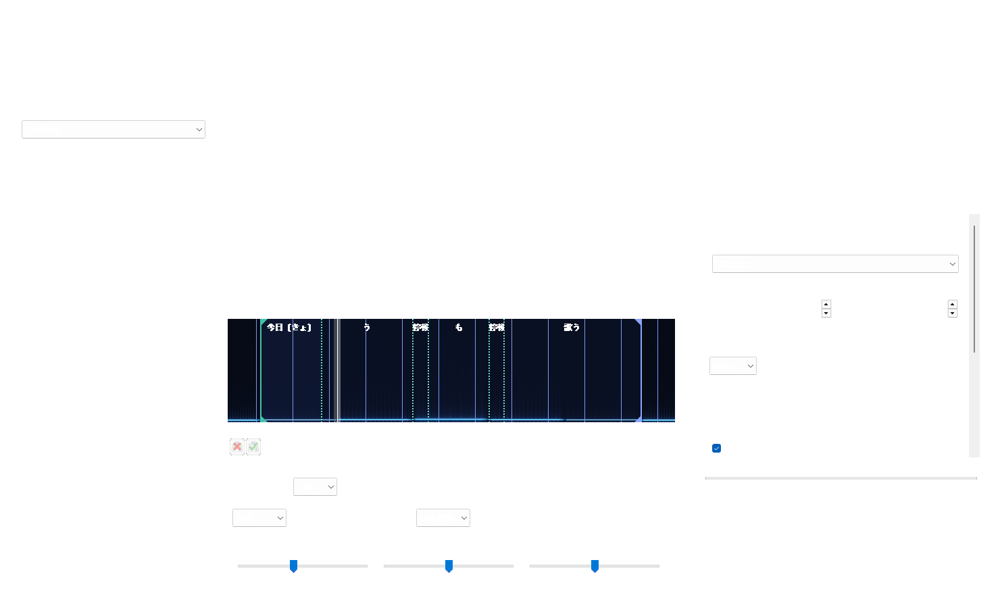
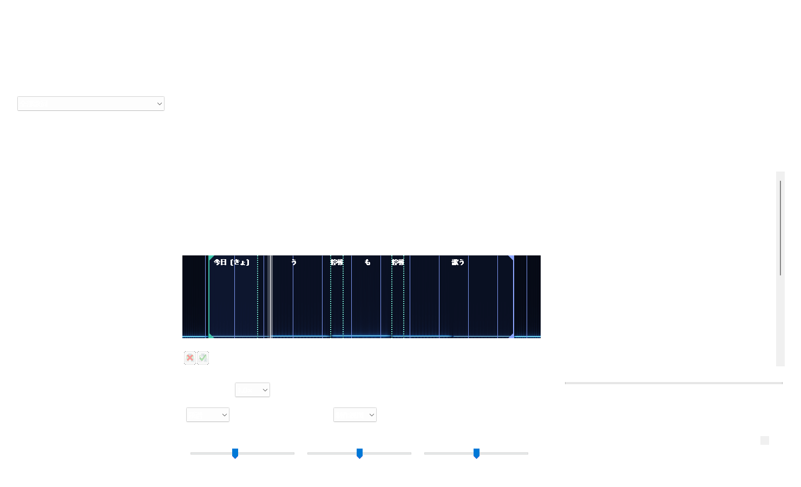

# 声稿 Karaoke Studio 0.7.0 使用说明

本软件基于 Aegisub 3.5.0，保留原生视频、波形、频谱、逐音节打轴与撤销功能，并增加云端初稿和日语注音工作区。

默认流程为“视频 + 普通歌词 → 转录并分行 → 人工校轴 → 读音复核 → 交付”，不要求 LRC。主窗口采用三栏面板，常用的起止微调、边界试听和确认下一行集中在校轴页上方。改进及验证范围见 `V07-USABILITY.md`。

## 启动

0.7 的中央卡片会显示当前歌词和下一步。首次使用可点右上“新手指南”，用不联网示例熟悉试听、拖边界、停顿处理和撤销。右侧显示已确认句数，导入页集中放置添加媒体、粘贴歌词和联网制作入口；联网和离线制作并排显示在首屏；复用转录和打开工程收在“更多导入”。

“应用本行修改”只把侧栏草稿应用到当前工程。Ctrl+S 或顶栏“保存工程”才将工程保存到文件；顶栏圆点表示文件有修改。开始试听不需要 API；联网转录和 DeepSeek 需自己的服务账号。

请从完整解压的 `ShengaoKaraoke-0.7.0-final-win64` 目录启动 `shengao-karaoke.exe`。软件内置离线日语词典，已有工程及 API 加密设置继续使用，无需重新填写密钥。

分词条使用自然字宽，不再为每个词添加空格或等宽字格；原歌词里真正的空格保持。停顿不单独形成空格或双分隔线，时间轴仍保留实际静音。普通歌词点击分隔线可合并，提交前可取消，提交后可撤销。带注音的词条单击选音节、双击试听；结构拆合在注音页进行，避免破坏假名标记。已有工程无需重新转录或分词。

完整解压后，双击 `shengao-karaoke.exe`。无需安装 Python。可选运行 `install.cmd` 安装到当前用户的程序目录并创建开始菜单快捷方式；不需要管理员权限。

## 四阶段制作流程

1. **导入**：点击“添加视频或音频”，或直接拖入媒体、ASS、JSON、LRC。粘贴普通歌词，每行一句，再点击“转录并按原歌词分行”；没有原歌词时可只生成识别初稿。JSON 打开工程；LRC 会追加；粘贴原歌词可选择替换现有歌词或追加。替换保留媒体并支持撤销，原文首尾空格也会保留。
2. **校轴**：点击播放区“逐词校对”，进入卡拉 OK 模式。拖动整行两端或中间音节边界，或使用右侧的起止微调、边界试听和确认下一行。需要重新对齐时，在高级工具中选择 ElevenLabs。
3. **注音复核**：点击“二次分析”，使用当前媒体转录和词典离线复核；也可勾选 DeepSeek 结合上下句生成读音和译文。结果先查看原／建议假名与罗马音及对应转录，试听后手动勾选应用。
4. **人工确认**：在注音表格修改读音，例如“今日”写成“きょ|う”，形成两个演唱音节。新拆分为估算时间，需试听校准。“时间已人工确认”保护自动时间处理，仍允许读音复核；明确手改的假名和罗马音默认单独保护。“保护人工结果”锁定整行，所有自动分析跳过。改变读音或时间后需重新试听确认。
5. **保存**：底部“应用本行修改”独占一行，先将当前侧栏内容同步到工程；Ctrl+S 将工程写入文件。切换阶段保留草稿；“上一行／下一行／下一待校准”会先保存当前侧栏。若原行同时在其他位置修改，软件会阻止覆盖；可放弃侧栏草稿后重新读取。
6. **导出**：运行字幕检查，点击问题可定位对应行。修正问题后刷新成品预览，再导出卡拉 OK／注音 ASS。假名、罗马音与译文可分别开关。纯音频可在“工具 → 视频工具”创建空白视频预览。

## 人工二次校轴

播放区的“制作视图”可切换为“专注打轴”或“放大预览”，分别扩大时间轴或视频。回到校轴页、按 F6 定位会重新显示时间轴；切换视图保留当前编辑。

添加媒体并得到粗轴后，点播放区“逐词校对”。波形／频谱两端的绿色、蓝色手柄可调整整行开始和结束，中间竖线调整音节。命中区域已经扩大；松开鼠标即写入文档，不必开启自动提交，每次拖动可以单独撤销。不能拖过相邻边界。ASS 以 10ms 保存，显示位置与实际时间使用相同精度。

校轴页上方可选择“整行起止”或一个原文词组，输入开始／结束毫秒后点“应用时间”，也可按 10／50／100ms 微调。两个词原本相接时会一起移动共享边界，避免产生重叠；本来存在的停顿仍保留。修改整行两端会尽量保留中间人工音节；压缩范围过窄时重新估算并提示试听。

“听起点”和“听终点”播放边界前后的声音，“听整段”播放当前范围；Esc 或播放区停止按钮立即停止，也会取消循环。“定位／放大”使所选范围完整进入时间轴，F6 定位当前行。“换行时自动定位时间轴”默认开启。

试听无误后点“确认 → 下一行”，或 Ctrl+Enter：当前时间标为人工确认，进入下一待校准行。可撤销。上一词／下一词和换行前会保存侧栏草稿；关闭时可以保存、放弃或取消，后台结果不会覆盖尚未应用的时间草稿。

分词、音节生成、对齐、循环和批量偏移放在校轴页下方的高级工具中。播放区可以切换柔和波形、传统波形、频谱及慢放；0.5×／0.75× 试听会变调。

## 停顿保留或合并

校轴页点“停顿 · N处”，会列出词间及词内假名音节之间没有歌词高亮的时间。可处理当前行、左侧选中行或全部歌词；锁定行／词跳过并显示数量。行首和行尾空白默认不列出，可以主动勾选“也列出整行开头／结尾的空白”。

选择列表中的一项可试听停顿前后的声音。处理方式有三种：保留停顿、并入前一音节（延长前一个字）、并入后一音节（让下一个字提前）。下方预览显示该音节将改到的准确边界。开头只能并入第一个音节，结尾只能并入最后一个音节。

默认保留时间，仅预勾选 ≤120ms 的内部短停顿；长停顿需手动勾选。可修改毫秒阈值后筛选，或使用全选／清空。只有勾选的项在点击“应用选择”后改变；取消不改工程。

合并会实际修改打 K、可编辑 ASS 和成品导出的音节时间。原歌词、分组、读音、样式及整行起止保持，未选停顿保持；修改后需重新确认时间。整次处理可 Ctrl+Z 撤销。保存 ASS 后再次打开也保留修改，不必重新请求 API。

## 日语汉字读音二次复核

校轴页点“二次分析”，或注音页点转录辅助复核。默认使用离线模式，可选左侧选中行或全部未保护歌词。软件寻找同一媒体的最近转录；新任务还核对文件大小和修改时间，跳过媒体已被替换的记录。旧转录没有版本信息时会提示，也可以手动浏览已有结果 JSON。

离线分析结合原文词组、已有读音、词典以及该行时间附近的转录。只有转录明确给出假名且时间覆盖合适时，才提出转录读音候选；识别结果仍为同一个汉字时，不会将它当成发音证据。没有转录时仍可提供词典候选，并明确显示缺少转录。原歌词、标点、空格和分组保持。

勾选“使用 DeepSeek”后，会将原歌词分组、附近转录、上下句和词典读音发给已配置的模型，复核特殊读音及译文；不发送音视频。模型返回改字、改变分词、把汉字或中文放入假名等无效结果会被拒绝。模型并不直接听歌，特殊唱法还需要人工试听。

“保留明确手工修改的注音”默认开启，保护手改假名及罗马音；如需重新分析这些词，可主动取消勾选。旧版未记录读音来源的内容可以选“保留旧版来源不明的读音”，默认允许提出审核候选。人工确认的时间保持，但仍可复核读音；锁定行／词跳过。

短空隙阈值默认 120ms，填 0 不处理。只收拢未人工校准的词间短间隔；长停顿、手工时间、已确认时间保持。这不会改写原转录缓存。歌词条没有空格不代表音频中没有停顿，请结合时间轴和试听判断。

完成后点“审核结果”，先看原读音 → 建议读音、罗马音变化及转录／词典／DeepSeek 依据，再试听。读音建议一律默认不勾选；只勾选需要应用的行，确定才写入，取消保持工程。读音变化后重新生成的音节属于估算；读音未变的手工音节保留。复核依据和人工保护状态随 ASS／JSON 工程保存。

DeepSeek 分批处理，已完成批次会缓存；后续批次失败时保留已完成结果，不自动重试付费请求。再次提交相同内容和模型可以复用成功批次。

## 普通歌词匹配

不必准备 LRC。添加视频后，粘贴已校对的普通歌词，选择 ElevenLabs 或 Microsoft MAI，然后点击“转录并按原歌词分行”。音频用于转录，正确歌词的匹配在本机完成，不再增加一次对齐 API 调用。

“复用已有转录 · 本地匹配”可选择本机最近转录任务或浏览转录 JSON。它不要求密钥、不联网，也不收费。默认只处理选中歌词，也可处理全部。勾选时间范围后可手填开始 / 结束秒数，并试听范围，以定位正确副歌。转录缓存独立于正确歌词；修改分行后可以复用原转录。

审核中显示文字相似度、覆盖率、归一化识别对应和原因。低可信、重复片段及未匹配建议默认不勾选，人工确认后才应用。未找到足够对应的行保留原时间。锁定、音节锁定及已人工确认的行在匹配中保留，不由自动结果重打时间。

匹配时间是粗轴，文字相似度不是声学置信度。词级时间细分、缺字插补属于估算，需要试听；仍可用 ElevenLabs 对齐和原生音节打轴细调。比较会统一全半角、标点及平片假名；可通过词典读音辅助匹配汉字和假名写法，审核中会标明方式；同音短词、特殊唱法与漏唱仍需要人工校准。

## 本地分词、音节与手动修正

匹配以原歌词为准，不把识别多余的空格、分行和词边界带入歌词。“校轴”页可选择处理选中行或全部未保护歌词，先点“本地按原歌词分词＋假名”，再点“按读音拆演唱音节”。两步均在本机完成，结果先审核再应用。已有读音时可以直接拆音节。

例如“今日”保持为一个原文词组，假名“きょう”拆为“きょ｜う”。新边界为估算；已人工调整且读音不变的音节边界保留。锁定或已确认行跳过。

“注音”页点选表格中的词组后，可“拆分所选词”或“与下一词合并”。拆分用 | 指定原文边界，不能增删原文和空格，可同时填写假名。合并会保留已有音节和停顿，均可撤销。词典不是歌曲唱法的最终判断，可手动改读音或用 DeepSeek 修正。

审核窗口可以试听当前建议、停止播放，并切换副歌候选。候选只改待审核数据；点确定才应用，取消保持工程。低可信建议默认不勾选；没有合适候选时，可回到本地匹配，指定该句出现的时间段重做，不需要再转录。

## 新窗口与歌词库

顶栏提供项目、保存、撤销重做、工具和窗口控制；拖动顶栏空白处移动，双击最大化或还原。左侧可按原文、假名和罗马音搜索，并筛选未确认、匹配待确认或已保护行。Ctrl / Shift 支持多选，双击歌词卡片编辑原文和起止时间，修改可撤销。修改原文会清除这行旧注音及逐字时间，以免沿用错误资料。

波形下方第一行是播放、停止、慢放和当前位置，第二行是波形／频谱、逐词校对和定位本行，再下方控制缩放、高度与音量。窄窗口仍保留完整控制。更多原生字幕、样式、查找、音频及视频命令集中在“工具”。Ctrl+S 保存工程。

## 批量偏移与 LRC

“校轴 → 批量偏移时间”可以只移动所选行或全部歌词。正数延后，负数提前；音节、假名与静音间隔一起移动。原有 ASS 标签和人工锁定会保留，操作可撤销。若任一行会出现负时间，整批不应用。原生 ASS 使用 10 毫秒精度，偏移请输入 10 的整数倍；整体移动不会把原先的估算时间变成精确时间。

标准 LRC 支持多时间标签、秒的小数和全局 `[offset:100]` 等偏移。UTF-8、带 BOM 的文件通过实际编码读取；结束时间以后一条时间标签或媒体结束点作为粗略边界，仍需校准。暂不支持带 `<00:01.00>` 逐字标签的增强 LRC，会明确拒绝导入。LRC 的毫秒时间在原生 ASS 中按 10 毫秒精度表示。

## 工作区预览

以下为程序自身的离屏渲染，使用合成素材，不是桌面截图。歌词卡片与表格使用本程序绘制 / 打印接口；OpenGL 画面由同一原生字幕渲染器合成到实际视频区域。

## 字幕检查与预览

检查会列出缺少音节时间、估算时间、零时长、行间重叠、汉字缺少读音、匹配歧义和未人工确认的行。可按类别筛选、点击定位或跳到下一待校准行。合唱的行间重叠可以保留，请结合试听判断。

文档或显示选项改变后，界面会提示成品预览需要刷新；“刷新视频中的注音成品预览”使用当前内容重新生成。导出使用当前工程数据，独立于此前预览是否过期。

## 保存与重开

- Ctrl+S 保存的是可继续编辑的 ASS 工程，包含侧栏注音、人工锁定和已应用的 API 结果。原生自动保存用于恢复已经提交到文档的内容；侧栏编辑完成后应及时保存。
- “导出工程 JSON”保存歌词结构、读音、时间、媒体引用和接口结果；通过“打开声稿工程 JSON”重开。
- 成品 ASS 用于支持 ASS 的播放器和压制工具，默认 1920×1080。它包含经过定位的假名和高亮事件，不必运行卡拉 OK 模板。用软件制作后若继续修改，优先保留可编辑 ASS 或 JSON 工程。
- SRT 只保留整句时间和原文，TXT 只保留原文；这两个格式无法保留逐音节高亮或注音布局。
- 项目不打包视频本身。移动工程后，媒体不存在时需重新打开对应的音视频。

## API 设置

ElevenLabs 填 API Key，识别调用 Scribe v2，已有歌词调用 Forced Alignment。最早的 Text to Speech 示例用于生成语音，不用于识别歌曲。

Microsoft MAI 使用 Azure Speech 资源的 HTTPS 根地址与资源密钥。例如 `https://资源名.cognitiveservices.azure.com`。当前对接 MAI-Transcribe-2，账号资源需有相应区域和模型访问权限。词级时间仍需人工细分和试听。

DeepSeek 填 API Key 和账号支持的模型名称。软件验证返回的原文分组，不接受改字、漏字、重复行 ID 或汉字冒充假名。特殊唱法、当て字及语境读音仍需人工确认。

密钥使用当前 Windows 用户的 DPAPI 加密，保存在 `%APPDATA%\ShengaoKaraoke`，不包含在导出工程中。设置中可删除已保存密钥；若使用环境变量，还需自行清除该环境变量。

## 任务失败

后台不自动重复提交付费请求。成功的识别／对齐结果有本地缓存。转录按媒体和服务设置复用，不依赖正确歌词；对齐按媒体、歌词与范围设置复用。如果转录已返回但匹配失败，结果也会保留，可从“复用已有转录”读取。

连接失败、HTTP 错误、上传中断和等待中断分别记录在任务目录的 `result.json` 中，包括耗时和已上传字节数等诊断。诊断保存在用户目录的 `tasks` 下。若服务器已收到音频，本地取消或断线不保证服务器停止处理或计费；先检查服务账户的请求记录。

## 任务记录与结果恢复

底部“任务记录”显示最近 50 项识别、对齐、注音及二次复核任务，可以查看失败原因与已返回的数据；部分完成的任务会标注。“恢复成功结果并审核”只读取本机文件，不重新调用云端。关闭审核窗口后，也可以从这里再次打开结果。

重开工程后，软件会通过歌词、时间、读音及人工状态重新匹配。已修改、已锁定或匹配不唯一的行会跳过；同一份已经应用的识别结果不能再次追加。若需要重新应用，先撤销此前的应用。旧版没有恢复元数据的任务不会自动推测匹配关系。

## 当前验证范围

开发测试使用合成音频与本机模拟 HTTP 服务，没有上传用户歌曲或使用用户密钥。实际账户权限和演唱识别准确度需要用你配置的账号验证。0.7 覆盖首次使用、新手指南、停顿保留和双向合并、视图切换，以及自然字宽、整行两端拖动、逐词微调、试听、草稿保护、确认下一行、当前媒体转录复核、读音保护、分批失败缓存及 ASS 重开，并回归既有匹配、窄窗口和保存功能。详细证据见 `V07-USABILITY.md`，既有设计记录保留在 `V04-UI.md` 和 `V05-USABILITY.md`。
